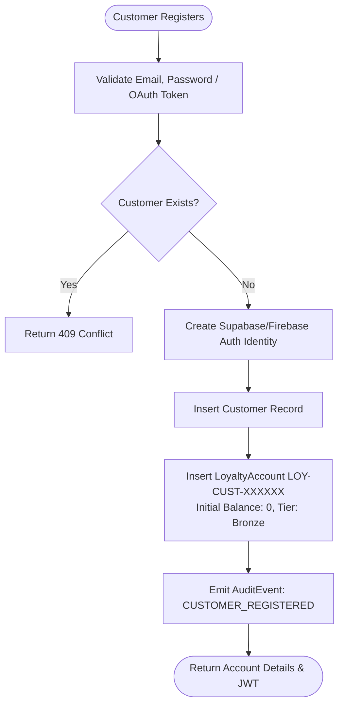
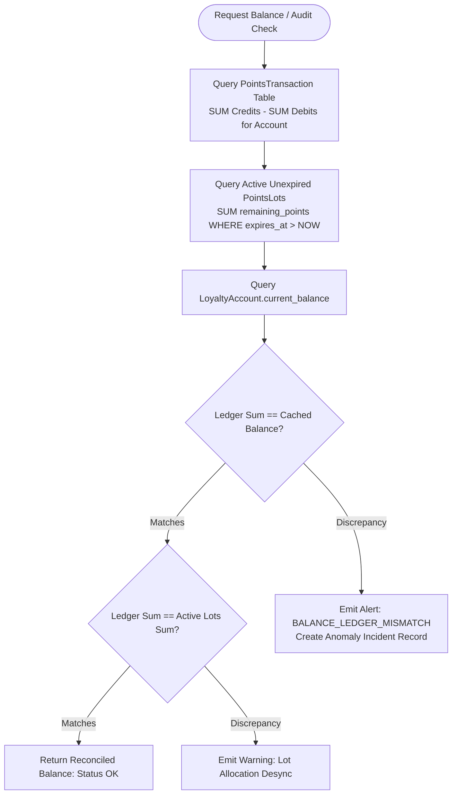
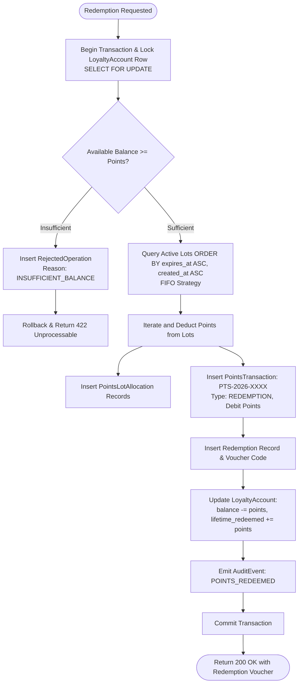
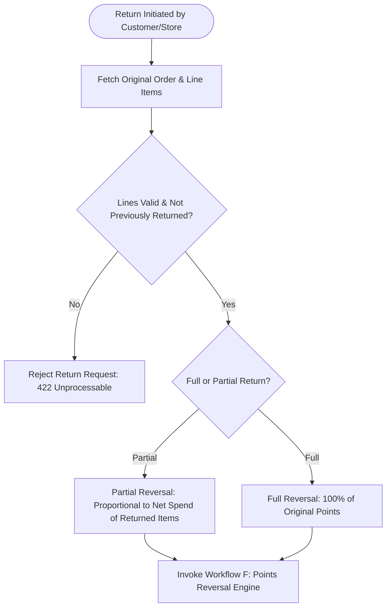
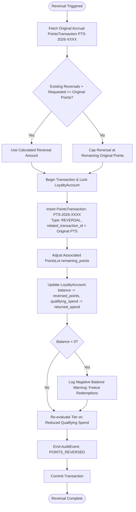
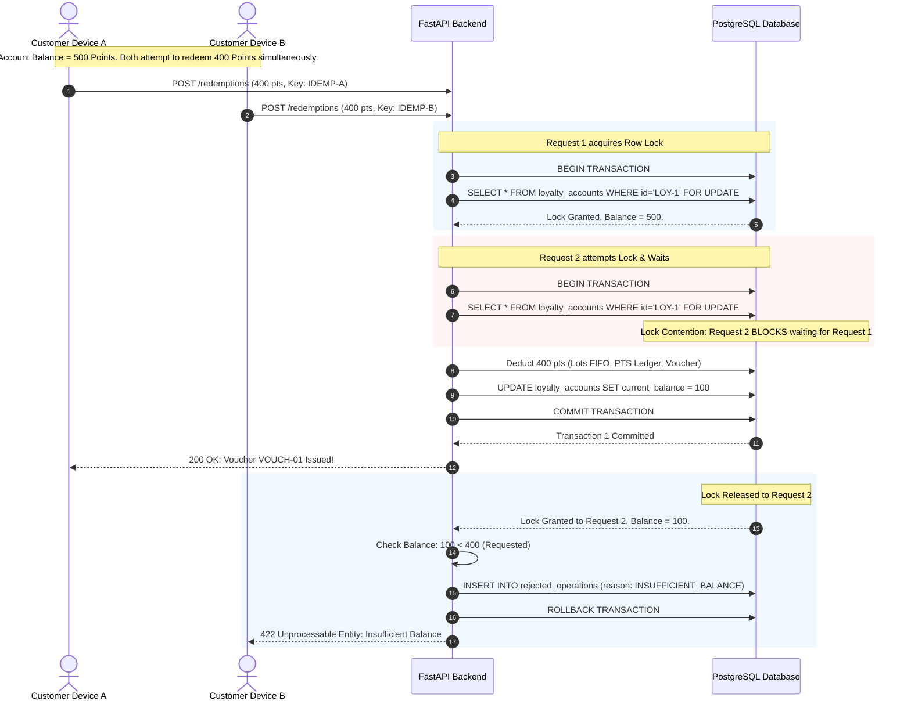
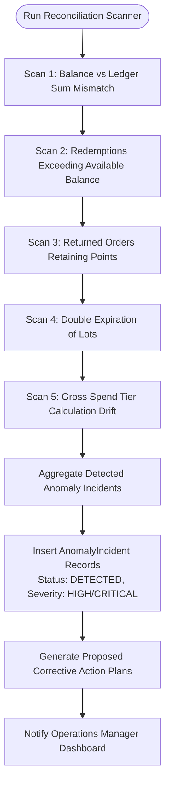
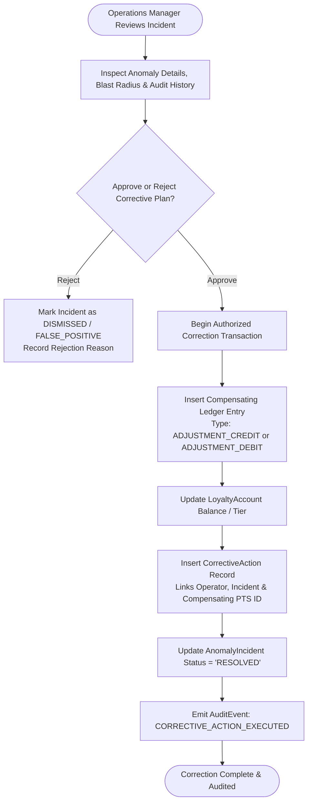

# 03. Business Workflow Specifications

This document defines the 12 core end-to-end business workflows governing the YottaFlex loyalty ledger platform. Each workflow specifies triggers, actors, inputs, preconditions, business rules, processing steps, database operations, outcomes, audit events, and edge cases, accompanied by Mermaid flowcharts for major processes.

---

## Workflow A: Customer Registration and Loyalty-Account Creation



- **Trigger**: New customer signs up via Email/Password or Google OAuth.
- **Actor**: Customer.
- **Input**: `email`, `password_hash` (or OAuth token), `first_name`, `last_name`, `phone`.
- **Preconditions**: Email must be a valid format; customer record must not already exist with this email.
- **Business Rules**:
  - Every registered customer receives exactly one `LoyaltyAccount` initialized with zero points (`current_balance = 0, lifetime_accrued = 0, lifetime_redeemed = 0`).
  - Default tier assigned is the baseline tier (`Bronze`, earning multiplier 1.0x).
  - Account ID follows the immutable format `LOY-<customer_id>`.
- **Processing Steps**:
  1. Authenticate identity via Supabase Auth or Firebase Auth.
  2. Start database transaction.
  3. Insert record into `Customer` table with unique email constraint.
  4. Generate `LoyaltyAccount` with default Bronze tier and 0 balance.
  5. Create `UserIdentityMapping` record linking external auth UID to internal `customer_id`.
  6. Emit `CUSTOMER_REGISTERED` audit event.
  7. Commit transaction and return customer profile with session tokens.
- **Database Operations**:
  - `INSERT INTO customers (...) VALUES (...);`
  - `INSERT INTO loyalty_accounts (account_id, customer_id, tier_id, current_balance, ...) VALUES (...);`
  - `INSERT INTO user_identity_mappings (...) VALUES (...);`
  - `INSERT INTO audit_events (...) VALUES (...);`
- **Successful Outcome**: Customer and LoyaltyAccount active; 201 Created returned.
- **Failure Outcome**: 409 Conflict if email exists; 422 Unprocessable Entity if input invalid; full transaction rollback.
- **Audit Events**: `CUSTOMER_REGISTERED` with actor ID, customer ID, assigned loyalty account ID, and timestamp.
- **Edge Cases**:
  - Duplicate registration attempt with identical email via different auth provider (handled via identity linking workflow).
  - Transient network failure between auth creation and database insert (wrapped in idempotency check).

---

## Workflow B: Order Creation and Points Accrual

```mermaid
flowchart TD
    OrderPlaced([Order Placed / Completed]) --> NetSpend[Calculate Eligible Net Spend<br>Exclude Tax, Shipping, Gift Cards]
    NetSpend --> CheckEligible{Eligible Spend > 0?}
    CheckEligible -- No --> NoPoints[Order Completed with 0 Points Accrued]
    CheckEligible -- Yes --> FetchTier[Fetch Customer Tier & Active Rules]
    FetchTier --> CalcPoints[Points = FLOOR(Net Spend * Tier Rate * Rule Multipliers)]
    CalcPoints --> BeginTx[Begin ACID Database Transaction]
    BeginTx --> InsertPTS[Insert PointsTransaction: PTS-2026-XXXX<br>Type: ACCRUAL, Positive Points]
    InsertPTS --> InsertLot[Insert PointsLot: LOT-2026-XXXX<br>Expires At: Accrual + 365 Days]
    InsertLot --> UpdateAccount[Update LoyaltyAccount:<br>balance += points, lifetime_accrued += points]
    UpdateAccount --> CheckTierProgression[Update Qualifying Spend & Evaluate Tier Progression]
    CheckTierProgression --> LogAudit[Emit AuditEvent: POINTS_ACCRUED]
    LogAudit --> CommitTx[Commit Transaction]
    CommitTx --> Success([Return Accrual Summary])
```

- **Trigger**: Order status transitions to `COMPLETED` or `PAID`.
- **Actor**: Customer (initiator), Store/Warehouse Operator (or E-commerce webhook).
- **Input**: `order_id`, `customer_id`, `order_lines` (item IDs, quantities, gross prices, discounts), `tax_amount`, `shipping_amount`.
- **Preconditions**: Customer has an active `LoyaltyAccount`; order has not been previously processed for accrual (`order.accrual_status == 'PENDING'`).
- **Business Rules**:
  - `Eligible Net Spend = SUM(line_total - item_discounts)` for eligible SKUs. Exclude shipping, taxes, and gift cards.
  - Base points: `FLOOR(eligible_net_spend * tier.earning_multiplier * rule.multiplier)`.
  - Points ledger is append-only: create `PointsTransaction` with `entry_type='ACCRUAL'`.
  - Create linked `PointsLot` with `initial_points = points`, `remaining_points = points`, `status='ACTIVE'`, `expires_at = NOW() + INTERVAL '365 days'`.
  - Update customer's cumulative `qualifying_spend` and trigger tier re-evaluation.
- **Processing Steps**:
  1. Verify idempotency key in request header.
  2. Parse order lines and calculate eligible net spend.
  3. Query active `LoyaltyAccount`, current `Tier`, and applicable promotion `Rules`.
  4. Compute points using integer floor rounding.
  5. Begin database transaction.
  6. Insert `PointsTransaction` (`PTS-2026-XXXXXXXX`).
  7. Insert `PointsLot` (`LOT-2026-XXXXXXXX`) with 365-day expiry.
  8. Update `LoyaltyAccount` cached balance and qualifying spend.
  9. Check if qualifying spend qualifies for tier upgrade (apply if eligible).
  10. Emit `POINTS_ACCRUED` audit event.
  11. Commit transaction and return points earned.
- **Database Operations**:
  - `INSERT INTO points_transactions (transaction_id, account_id, order_id, entry_type, points, ...) VALUES (...);`
  - `INSERT INTO points_lots (lot_id, transaction_id, account_id, initial_points, remaining_points, expires_at, status) VALUES (...);`
  - `UPDATE loyalty_accounts SET current_balance = current_balance + :pts, qualifying_spend = qualifying_spend + :net_spend, updated_at = NOW() WHERE account_id = :acc_id;`
  - `INSERT INTO audit_events (...) VALUES (...);`
- **Successful Outcome**: Points credited to ledger, lot active, balance updated, tier evaluated; 200 OK.
- **Failure Outcome**: Idempotent 200 returned if already processed; 404 if customer/order missing; 500 triggers complete rollback.
- **Audit Events**: `POINTS_ACCRUED` capturing order ID, eligible net spend, points earned, tier multiplier, and lot ID.
- **Edge Cases**:
  - Zero eligible net spend (e.g., 100% discount or gift card only): record order with 0 points accrued; emit audit note.
  - Micro-transactions yielding 0 points after floor rounding: recorded gracefully.

---

## Workflow C: Customer Points Balance Calculation & Reconciliation



- **Trigger**: Customer opens balance dashboard; or scheduled reconciliation worker runs.
- **Actor**: Customer (view), Operations Manager (reconciliation), System (health check).
- **Input**: `account_id` (or `customer_id`).
- **Preconditions**: Account exists in the database.
- **Business Rules**:
  - **Single Source of Truth**: The ledger (`PointsTransaction`) is the authoritative source of points balance:
    $$\text{LedgerBalance} = \sum_{t \in \text{Credits}} t.\text{points} - \sum_{t \in \text{Debits}} t.\text{points}$$
  - **Lot Balance Invariant**: The sum of `remaining_points` across all `ACTIVE` and `PARTIALLY_REDEEMED` lots where `expires_at > NOW()` must equal the unexpired available balance.
  - If `cached_balance != LedgerBalance`, an anomaly event `BALANCE_LEDGER_MISMATCH` is triggered.
- **Processing Steps**:
  1. Execute read query calculating net points from `PointsTransaction` for `account_id`.
  2. Execute read query summing active unexpired lots.
  3. Fetch `current_balance` from `LoyaltyAccount`.
  4. Compare values. If variance detected, log an anomaly incident with variance magnitude.
  5. Return balance breakdown (total earned, redeemed, expired, reversed, available).
- **Database Operations**:
  - `SELECT COALESCE(SUM(CASE WHEN entry_type IN ('ACCRUAL', 'ADJUSTMENT_CREDIT') THEN points WHEN entry_type IN ('REDEMPTION', 'REVERSAL', 'EXPIRY', 'ADJUSTMENT_DEBIT') THEN -points ELSE 0 END), 0) FROM points_transactions WHERE account_id = :acc_id;`
  - `SELECT COALESCE(SUM(remaining_points), 0) FROM points_lots WHERE account_id = :acc_id AND status IN ('ACTIVE', 'PARTIALLY_REDEEMED') AND expires_at > NOW();`
- **Successful Outcome**: Reconciled points balance returned; discrepancy report zero.
- **Failure Outcome**: If mismatch found, anomaly logged and corrective action ticket queued.
- **Audit Events**: `RECONCILIATION_CHECK` logged during batch audits.

---

## Workflow D: Points Redemption (Atomic & FIFO Lot Allocation)



- **Trigger**: Customer clicks "Redeem Points" in store checkout or rewards catalog.
- **Actor**: Customer.
- **Input**: `account_id`, `reward_id` (or custom point amount), `idempotency_key`.
- **Preconditions**: Customer is authenticated; requested reward exists and is active.
- **Business Rules**:
  - Concurrency Control: Must acquire a row lock on `LoyaltyAccount` (`SELECT ... FOR UPDATE`) to prevent race conditions.
  - Validation: Requested points must be $\le$ available balance.
  - Allocation: Deductions must consume active unexpired points lots in strict **FIFO order** (`ORDER BY expires_at ASC, created_at ASC`).
  - Lot status updates:
    - If lot `remaining_points == deduction`: status becomes `EXHAUSTED`.
    - If lot `remaining_points > deduction`: status becomes `PARTIALLY_REDEEMED`.
  - Record audit voucher: Generate unique voucher code `VOUCH-XXXX-XXXX`.
- **Processing Steps**:
  1. Check idempotency record; if previously executed, return cached voucher response.
  2. Begin database transaction with Read Committed or Serializable isolation.
  3. Lock `LoyaltyAccount` row with `FOR UPDATE`.
  4. Query active unexpired points lots ordered by expiry date.
  5. Sum available points in lots. If sum < requested points:
     - Insert record into `RejectedOperation` with reason `INSUFFICIENT_BALANCE`.
     - Rollback transaction and return 422.
  6. Iterate through lots, allocating point deductions until requested total is satisfied.
  7. Insert `PointsLotAllocation` records linking redemption to each consumed lot.
  8. Insert `PointsTransaction` with `entry_type='REDEMPTION'` and negative points debit.
  9. Insert `Redemption` record with voucher code and status `ISSUED`.
  10. Update `LoyaltyAccount` balance and `lifetime_redeemed`.
  11. Emit `POINTS_REDEEMED` audit event.
  12. Commit transaction and return voucher details.
- **Database Operations**:
  - `SELECT * FROM loyalty_accounts WHERE account_id = :id FOR UPDATE;`
  - `SELECT * FROM points_lots WHERE account_id = :id AND status IN ('ACTIVE', 'PARTIALLY_REDEEMED') AND expires_at > NOW() ORDER BY expires_at ASC, created_at ASC FOR UPDATE;`
  - `UPDATE points_lots SET remaining_points = :rem, status = :status WHERE lot_id = :lot_id;`
  - `INSERT INTO points_lot_allocations (allocation_id, redemption_id, lot_id, points_allocated) VALUES (...);`
  - `INSERT INTO points_transactions (transaction_id, account_id, entry_type, points, ...) VALUES (...);`
  - `INSERT INTO redemptions (redemption_id, account_id, reward_id, points_redeemed, voucher_code, status) VALUES (...);`
  - `UPDATE loyalty_accounts SET current_balance = current_balance - :pts, lifetime_redeemed = lifetime_redeemed + :pts WHERE account_id = :id;`
- **Successful Outcome**: Points deducted, lot allocations recorded, voucher issued; 200 OK.
- **Failure Outcome**: 422 if insufficient points; 409 on concurrency conflict retry; 404 if reward inactive.
- **Audit Events**: `POINTS_REDEEMED` capturing reward ID, points redeemed, voucher code, and lot allocations.
- **Edge Cases**:
  - Multiple rapid concurrent redemption requests (serialized safely via `FOR UPDATE` lock).
  - Exact match of lot balance vs partial lot deduction.

---

## Workflow E: Full and Partial Order Returns



- **Trigger**: Customer returns items at store or warehouse receives returned package.
- **Actor**: Store/Warehouse Operator.
- **Input**: `order_id`, `returned_lines` (list of `order_line_id`, `quantity_returned`, `return_reason`).
- **Preconditions**: Original order exists in `COMPLETED` state; returned lines belong to order; quantities returned $\le$ purchased quantities - previously returned quantities.
- **Business Rules**:
  - A return can be **Full** (all items returned) or **Partial** (subset of items or quantities returned).
  - Returned items reduce eligible net spend for that order.
  - Triggers Workflow F (Points Reversal) to reverse points earned on returned items.
- **Processing Steps**:
  1. Retrieve order and existing return records.
  2. Validate that returned quantities do not exceed unreturned purchased quantities.
  3. Calculate returned eligible net spend.
  4. Create `OrderReturn` and `OrderReturnLine` records.
  5. Calculate points to reverse:
     $$\text{PointsToReverse} = \text{ROUND}\left( \frac{\text{Returned Eligible Net Spend}}{\text{Original Order Eligible Net Spend}} \times \text{Original Accrual Points} \right)$$
  6. Pass calculated reversal parameters to Workflow F.
- **Database Operations**:
  - `INSERT INTO order_returns (return_id, order_id, return_type, total_refund_amount, ...) VALUES (...);`
  - `INSERT INTO order_return_lines (return_line_id, return_id, order_line_id, quantity, ...) VALUES (...);`
- **Successful Outcome**: Return recorded in database; points reversal triggered; 200 OK.
- **Failure Outcome**: 422 if return quantity exceeds purchase; 404 if order not found.
- **Audit Events**: `ORDER_RETURN_PROCESSED` with return ID, order ID, items returned, and refund amount.
- **Edge Cases**:
  - Sequential partial returns on the same order (cumulative reversals tracked against accrual ceiling).

---

## Workflow F: Points Reversal (Proportional & Linked)



- **Trigger**: Invoked by Workflow E (Order Return) or operator manual reversal.
- **Actor**: Store/Warehouse Operator, System.
- **Input**: `order_id`, `return_id`, `points_to_reverse`, `returned_qualifying_spend`.
- **Preconditions**: Original accrual transaction exists; cumulative reversed points $\le$ original accrual points.
- **Business Rules**:
  - **Reversal Reference**: Every reversal transaction must set `related_transaction_id = original_accrual.transaction_id`.
  - **Reversal Ceiling**: Cumulative reversed points across all partial returns for an order cannot exceed the original points awarded.
  - **Negative Balance Handling**: If customer has already redeemed points, balance may drop below zero (`current_balance < 0`). Redemptions are blocked until balance $\ge 0$.
  - **Qualifying Spend Reduction**: `qualifying_spend` is decremented by the returned spend, triggering tier re-evaluation.
- **Processing Steps**:
  1. Retrieve original accrual transaction `PTS-2026-XXXXXXXX` for the order.
  2. Sum all existing reversals where `related_transaction_id == original_accrual.transaction_id`.
  3. Validate that `existing_reversals + points_to_reverse <= original_accrual.points`. Cap if necessary.
  4. Lock `LoyaltyAccount` row with `FOR UPDATE`.
  5. Insert `PointsTransaction` with `entry_type='REVERSAL'` and negative point amount.
  6. Adjust remaining points on the original `PointsLot` if unredeemed; if already redeemed, decrement account balance directly.
  7. Deduct returned amount from `LoyaltyAccount.qualifying_spend`.
  8. Emit `POINTS_REVERSED` audit event.
  9. Commit transaction.
- **Database Operations**:
  - `INSERT INTO points_transactions (transaction_id, account_id, order_id, related_transaction_id, entry_type, points, ...) VALUES (...);`
  - `UPDATE points_lots SET remaining_points = GREATEST(0, remaining_points - :rev_pts) WHERE lot_id = :original_lot_id;`
  - `UPDATE loyalty_accounts SET current_balance = current_balance - :rev_pts, qualifying_spend = GREATEST(0, qualifying_spend - :ret_spend) WHERE account_id = :acc_id;`
- **Successful Outcome**: Reversal transaction appended to ledger, balance adjusted, parent link intact.
- **Failure Outcome**: 422 if points exceed accrual ceiling; full rollback on error.
- **Audit Events**: `POINTS_REVERSED` capturing original transaction ID, reversal transaction ID, points deducted.
- **Edge Cases**:
  - Original points already partially or fully redeemed (handled via negative balance allowance).
  - Lot already expired before return (points still deducted from account balance).

---

## Workflow G: Points Expiry (Batch & Idempotent)

```mermaid
flowchart TD
    ScheduleTrigger([Scheduled Daily Expiry Job]) --> FetchExpiredLots[Query PointsLots WHERE expires_at <= NOW<br>AND remaining_points > 0<br>AND status IN ('ACTIVE', 'PARTIALLY_REDEEMED')]
    FetchExpiredLots --> CheckCount{Any Expired Lots Found?}
    CheckCount -- No --> FinishJob([Complete: 0 Lots Expired])
    CheckCount -- Yes --> CreateBatch[Insert ExpiryBatch: EXP-2026-XXXX<br>Status: IN_PROGRESS]
    CreateBatch --> BatchLoop[For Each Expired Lot]
    BatchLoop --> InsertExpiryPTS[Insert PointsTransaction: PTS-2026-XXXX<br>Type: EXPIRY, points: -lot.remaining_points]
    InsertExpiryPTS --> MarkLotExpired[UPDATE PointsLot SET remaining_points = 0, status = 'EXPIRED']
    MarkLotExpired --> UpdateAcc[UPDATE LoyaltyAccount SET current_balance = current_balance - expired_pts]
    UpdateAcc --> NextLot{More Lots in Batch?}
    NextLot -- Yes --> BatchLoop
    NextLot -- No --> CloseBatch[UPDATE ExpiryBatch SET status = 'COMPLETED', total_points_expired, total_lots_processed]
    CloseBatch --> LogAudit[Emit AuditEvent: EXPIRY_BATCH_COMPLETED]
    LogAudit --> FinishJob
```

- **Trigger**: Scheduled daily cron job (e.g., 00:01 UTC) or Operations Manager manual run.
- **Actor**: System (Cron), Operations Manager.
- **Input**: `cutoff_timestamp` (defaults to current time).
- **Preconditions**: Database reachable; active points lots exist.
- **Business Rules**:
  - **Idempotency**: An expired lot can only be expired once. Must query `status IN ('ACTIVE', 'PARTIALLY_REDEEMED') AND remaining_points > 0`.
  - Re-running the batch job on the same day must find zero remaining unexpired points for that cutoff, generating zero duplicate ledger entries.
  - Every batch receives a unique batch ID `EXP-2026-XXXXXXXX`.
  - Ledger debits are recorded with `entry_type='EXPIRY'`.
- **Processing Steps**:
  1. Generate unique `batch_id = 'EXP-2026-XXXXXXXX'`.
  2. Insert `ExpiryBatch` record with status `IN_PROGRESS`.
  3. Query candidate lots: `WHERE expires_at <= :cutoff AND remaining_points > 0 AND status != 'EXPIRED'`.
  4. Process in chunks of 500 lots:
     - Insert `PointsTransaction` entry for each lot.
     - Update lot `remaining_points = 0, status = 'EXPIRED'`.
     - Update parent `LoyaltyAccount` balance.
     - Insert record into `ExpiryBatchItem`.
  5. Update `ExpiryBatch` with total lots processed, total points expired, and status `COMPLETED`.
  6. Emit `EXPIRY_BATCH_COMPLETED` audit event.
- **Database Operations**:
  - `INSERT INTO expiry_batches (batch_id, cutoff_date, total_lots_processed, total_points_expired, status) VALUES (...);`
  - `INSERT INTO points_transactions (transaction_id, account_id, entry_type, points, ...) VALUES (...);`
  - `UPDATE points_lots SET remaining_points = 0, status = 'EXPIRED', updated_at = NOW() WHERE lot_id = :lot_id;`
  - `UPDATE loyalty_accounts SET current_balance = current_balance - :expired_pts WHERE account_id = :acc_id;`
- **Successful Outcome**: Expired points deducted, lots marked expired, batch summary logged.
- **Failure Outcome**: Batch status set to `FAILED` with error log; rollback of active chunk.
- **Audit Events**: `EXPIRY_BATCH_COMPLETED` with batch ID, lots processed count, points expired count.
- **Edge Cases**:
  - Idempotent re-run: 0 candidate lots found; batch completes cleanly with 0 points expired.
  - Partial lot (customer redeemed 40 of 100 points): only the remaining 60 points expire.

---

## Workflow H: Tier Progression and Downgrade Policy

- **Trigger**: Completion of order accrual, return reversal, or annual qualification anniversary check.
- **Actor**: System (Accrual/Reversal Service, Annual Tier Review Cron).
- **Input**: `account_id`, rolling window start date (`NOW() - INTERVAL '365 days'`).
- **Preconditions**: Account exists.
- **Business Rules**:
  - Tier determination is based strictly on **Qualifying Spend** accumulated within the rolling 365-day window.
  - **Tier Thresholds**:
    - Bronze: $0.00 – $499.99 (1.0x earning rate)
    - Silver: $500.00 – $999.99 (1.25x earning rate)
    - Gold: $1,000.00 – $2,499.99 (1.5x earning rate)
    - Platinum: $\ge \$2,500.00$ (2.0x earning rate)
  - **Upgrade**: Immediate upon order completion if qualifying spend meets/exceeds higher threshold.
  - **Downgrade**: Evaluated at customer's annual membership anniversary. If rolling spend is below current tier threshold, tier is adjusted to the highest qualified tier.
- **Processing Steps**:
  1. Calculate rolling qualifying spend:
     $$\text{QualifyingSpend} = \sum_{\text{eligible orders}} \text{eligible\_net\_spend} - \sum_{\text{returns}} \text{returned\_net\_spend}$$
  2. Determine target tier from threshold rules.
  3. If target tier > current tier (Upgrade):
     - Update `LoyaltyAccount.tier_id`.
     - Record `TierTransition` record with `transition_type='UPGRADE'`.
     - Emit `TIER_UPGRADED` audit event.
  4. If target tier < current tier on anniversary review (Downgrade):
     - Update `LoyaltyAccount.tier_id`.
     - Record `TierTransition` record with `transition_type='DOWNGRADE'`.
     - Emit `TIER_DOWNGRADED` audit event.
- **Database Operations**:
  - `UPDATE loyalty_accounts SET tier_id = :new_tier_id, updated_at = NOW() WHERE account_id = :acc_id;`
  - `INSERT INTO tier_transitions (transition_id, account_id, previous_tier_id, new_tier_id, qualifying_spend, transition_type) VALUES (...);`
- **Successful Outcome**: Tier updated with full transition history recorded.
- **Failure Outcome**: Logged warning if tier definition missing; transaction rollback.
- **Audit Events**: `TIER_UPGRADED` or `TIER_DOWNGRADED` with previous/new tiers and qualifying spend.
- **Edge Cases**:
  - Large return drops qualifying spend below tier threshold: tier remains unchanged until next review cycle, or immediate tier adjustment applied according to program policy.

---

## Workflow I: Concurrent Redemption Attempts



- **Trigger**: Simultaneous redemption requests submitted for the same loyalty account (e.g., rapid multi-click or dual-device login).
- **Actor**: Customer.
- **Input**: Two distinct redemption payloads with unique `Idempotency-Key` headers.
- **Preconditions**: Both requests pass JWT authentication for the same customer account.
- **Business Rules**:
  - Over-redemption must be strictly prevented. The second request must observe the updated balance after the first commits.
  - No deadlocks permitted; row lock serialization must order execution deterministically.
- **Processing Steps**:
  1. Transaction 1 locks `LoyaltyAccount` via `SELECT ... FOR UPDATE`.
  2. Transaction 2 requests `SELECT ... FOR UPDATE` on the same row and blocks.
  3. Transaction 1 verifies balance (500 $\ge$ 400), deducts 400 points, updates balance to 100, and commits.
  4. Lock is released to Transaction 2.
  5. Transaction 2 reads updated balance (100).
  6. Transaction 2 detects $100 < 400$, records rejection in `RejectedOperation`, rolls back, and returns 422.
- **Database Operations**:
  - Row locking: `SELECT * FROM loyalty_accounts WHERE account_id = :id FOR UPDATE;`
  - Rejection logging: `INSERT INTO rejected_operations (...) VALUES (...);`
- **Successful Outcome**: Exactly one request succeeds; second request cleanly rejected with 422; balance remains accurate (100).
- **Failure Outcome**: Deadlock timeout handled with automated retry (up to 3 attempts with exponential backoff).
- **Audit Events**: `POINTS_REDEEMED` for Request 1; `REDEMPTION_REJECTED` for Request 2.
- **Edge Cases**:
  - Submitting identical `Idempotency-Key`: Request 2 immediately returns cached 200 response from Request 1 without re-executing.

---

## Workflow J: Failed and Rejected Operations

- **Trigger**: Validation failure (insufficient balance, inactive reward, invalid order line, expired promo code).
- **Actor**: Customer, Store Operator, System.
- **Input**: Request payload that violates business rules.
- **Preconditions**: Request reaches application validation layer.
- **Business Rules**:
  - **No Ledger Pollution**: Rejected operations must NEVER insert rows into `PointsTransaction`. The ledger must remain 100% clean of failed transactions.
  - **Auditability**: The failure must be recorded in `RejectedOperation` with actor, error code, timestamp, and sanitized payload.
- **Processing Steps**:
  1. Validation rule fails in service layer (e.g., `balance < requested_points`).
  2. Record incident in `RejectedOperation` table in an independent transaction.
  3. Log warning in application telemetry.
  4. Return standardized RFC-7807 error response to client.
- **Database Operations**:
  - `INSERT INTO rejected_operations (operation_id, account_id, actor_id, operation_type, error_code, error_message, payload) VALUES (...);`
- **Successful Outcome**: Client receives informative 4xx error; security audit trail preserved; ledger untouched.
- **Failure Outcome**: 500 error if audit table write fails.
- **Audit Events**: `OPERATION_REJECTED` with reason code and actor ID.
- **Edge Cases**:
  - Malformed SQL injection in payload: sanitized by Pydantic and parameterized queries before logging.

---

## Workflow K: Anomaly Detection and Automated Reconciliation



- **Trigger**: Scheduled hourly reconciliation cron or manual trigger by Operations Manager.
- **Actor**: System (Scanner), Operations Manager.
- **Input**: None (scans entire database or scoped tenant).
- **Preconditions**: Database operational.
- **Business Rules**:
  - Detects all 5 designated anomaly categories:
    1. `BALANCE_LEDGER_MISMATCH`: Cached balance != Sum of ledger entries.
    2. `OVER_REDEMPTION`: Cumulative redemptions > cumulative available credits.
    3. `RETURN_WITHOUT_REVERSAL`: Completed return without corresponding reversal ledger entry.
    4. `DOUBLE_EXPIRATION`: Multiple expiry transactions for the same lot.
    5. `GROSS_SPEND_TIER_CALCULATION`: Tier assigned using gross invoice spend instead of qualifying spend.
  - Anomaly detection must NOT modify ledger data automatically. Corrective actions require authorized operator approval (Workflow L).
- **Processing Steps**:
  1. Execute analytical SQL queries for each anomaly pattern.
  2. For each detected anomaly, calculate variance magnitude and blast radius.
  3. Check if anomaly incident already exists in `OPEN` state (prevent duplicate incident generation).
  4. Insert `AnomalyIncident` record with rule violated, entity IDs, and supporting evidence.
  5. Generate proposed compensating ledger action.
  6. Return diagnostic summary report.
- **Database Operations**:
  - `INSERT INTO anomaly_incidents (incident_id, issue_type, entity_id, variance_amount, details, status) VALUES (...);`
- **Successful Outcome**: All anomalies flagged with evidence and queued for operator review.
- **Failure Outcome**: Scan failure logged with stack trace; alert dispatched.
- **Audit Events**: `ANOMALY_SCAN_COMPLETED` with total anomalies detected per category.
- **Edge Cases**:
  - Scan running concurrently with active transactions (handled via repeatable read transaction isolation or timestamp cutoffs).

---

## Workflow L: Operator Investigation and Corrective-Action Approval



- **Trigger**: Operations Manager reviews pending anomalies in the Admin Dashboard.
- **Actor**: Operations Manager (Authorized role).
- **Input**: `incident_id`, `decision` (`APPROVE` or `REJECT`), `approval_notes`.
- **Preconditions**: Incident status is `OPEN`; operator has `OPERATIONS_MANAGER` role.
- **Business Rules**:
  - **No History Deletion**: History is NEVER modified or deleted. Discrepancies are resolved solely through **compensating ledger transactions** (`ADJUSTMENT_CREDIT` or `ADJUSTMENT_DEBIT`).
  - Dual-control governance: Corrective action requires authorized operator approval.
  - The compensating transaction must reference the `incident_id` and `action_id`.
- **Processing Steps**:
  1. Verify operator role and JWT claims.
  2. Fetch incident details and proposed corrective plan.
  3. If approved:
     - Begin database transaction.
     - Generate compensating transaction `PTS-2026-XXXXXXXX` with debit or credit.
     - Update account cached balance.
     - Insert record into `CorrectiveAction`.
     - Update `AnomalyIncident` status to `RESOLVED`.
     - Emit `CORRECTIVE_ACTION_EXECUTED` audit event.
     - Commit transaction.
  4. If rejected:
     - Update `AnomalyIncident` status to `DISMISSED`.
     - Emit `ANOMALY_DISMISSED` audit event.
- **Database Operations**:
  - `INSERT INTO points_transactions (transaction_id, account_id, entry_type, points, notes, ...) VALUES (...);`
  - `UPDATE loyalty_accounts SET current_balance = current_balance + :adj_pts WHERE account_id = :acc_id;`
  - `INSERT INTO corrective_actions (action_id, incident_id, operator_id, compensating_transaction_id, notes) VALUES (...);`
  - `UPDATE anomaly_incidents SET status = 'RESOLVED', resolved_at = NOW() WHERE incident_id = :id;`
- **Successful Outcome**: Incident resolved, compensating entry appended to ledger, complete audit trail preserved.
- **Failure Outcome**: 403 Forbidden if non-manager attempts approval; rollback on DB error.
- **Audit Events**: `CORRECTIVE_ACTION_EXECUTED` with operator ID, incident ID, and compensating transaction ID.
- **Edge Cases**:
  - Operator attempts to approve an already resolved incident (idempotently rejected with 409 Conflict).
