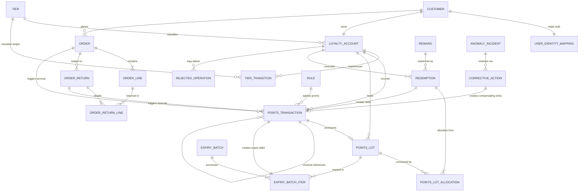

# 05. Database Schema and Entity Architecture

## 1. Relational Architecture & Design Philosophy

The YottaFlex database tier is architected on **PostgreSQL** (hosted via Supabase) and implements a financial-grade ledger design pattern:
1. **Append-Only Immutability**: The core journal table `points_transactions` strictly forbids `UPDATE` and `DELETE` operations via database triggers and application constraints.
2. **Explicit Lot Allocation**: Point consumption (redemption) and expiration are mapped to individual accrual lots (`points_lots`) via the bridge table `points_lot_allocations`.
3. **Rigorous Referential Integrity**: All foreign keys enforce `ON DELETE RESTRICT` or `ON DELETE CASCADE` where appropriate, preventing orphaned records.
4. **Deterministic ID Conventions**: Primary keys utilize human-readable, typed, zero-padded identifier prefixes:
   - `Customer`: `CUST-000001`
   - `LoyaltyAccount`: `LOY-<customer_id>`
   - `Tier`: `TIER-BRONZE`, `TIER-SILVER`, etc.
   - `Order`: `ORD-2026-000001`
   - `OrderLine`: `ORDL-2026-000001-01`
   - `PointsTransaction`: `PTS-2026-00000001`
   - `PointsLot`: `LOT-2026-00000001`
   - `Redemption`: `RDM-2026-000001`
   - `Reward`: `RWD-0001`
   - `ExpiryBatch`: `EXP-2026-000001`
   - `AuditEvent`: `AUD-2026-00000001`

---

## 2. Complete Entity-Relationship (ER) Diagram



---

## 3. Detailed Data Dictionary

### Entity 1: `customers`
- **Purpose**: Stores master profile for loyalty participants.
- **Primary Key**: `customer_id` (VARCHAR(32), e.g., `CUST-000001`).
- **Foreign Keys**: None.
- **Fields**:
  | Field Name | Data Type | Nullable | Unique | Default / Allowed Values | Validation Rule |
  |---|---|---|---|---|---|
  | `customer_id` | VARCHAR(32) | NO | YES | `CUST-XXXXXX` | Must match regex `^CUST-[0-9]{6}$` |
  | `email` | VARCHAR(255) | NO | YES | Valid email string | Standard RFC 5322 email regex |
  | `first_name` | VARCHAR(100) | NO | NO | Text string | Non-empty, 1-100 characters |
  | `last_name` | VARCHAR(100) | NO | NO | Text string | Non-empty, 1-100 characters |
  | `phone` | VARCHAR(20) | YES | NO | E.164 phone string | Optional international format |
  | `status` | VARCHAR(20) | NO | NO | `'ACTIVE'`, `'SUSPENDED'`, `'CLOSED'` | In enum list |
  | `created_at` | TIMESTAMPTZ | NO | NO | `NOW()` | ISO 8601 UTC timestamp |
  | `updated_at` | TIMESTAMPTZ | NO | NO | `NOW()` | $\ge$ `created_at` |
- **Relationships**:
  - 1:1 with `LoyaltyAccount` (mandatory).
  - 1:1 with `UserIdentityMapping` (mandatory).
  - 1:N with `Order` (optional).

---

### Entity 2: `loyalty_accounts`
- **Purpose**: Represents the isolated financial container and point balance for a customer.
- **Primary Key**: `account_id` (VARCHAR(32), e.g., `LOY-CUST-000001`).
- **Foreign Keys**:
  - `customer_id` $\to$ `customers.customer_id` (ON DELETE RESTRICT).
  - `tier_id` $\to$ `tiers.tier_id` (ON DELETE RESTRICT).
- **Fields**:
  | Field Name | Data Type | Nullable | Unique | Default / Allowed Values | Validation Rule |
  |---|---|---|---|---|---|
  | `account_id` | VARCHAR(32) | NO | YES | `LOY-<customer_id>` | Immutable ID convention |
  | `customer_id` | VARCHAR(32) | NO | YES | FK to Customer | Exactly 1 account per customer |
  | `tier_id` | VARCHAR(32) | NO | NO | Default `'TIER-BRONZE'` | Valid FK to Tier |
  | `current_balance` | INTEGER | NO | NO | `0` | Reconciles with ledger sum |
  | `lifetime_accrued` | INTEGER | NO | NO | `0` | $\ge 0$ |
  | `lifetime_redeemed`| INTEGER | NO | NO | `0` | $\ge 0$ |
  | `qualifying_spend` | NUMERIC(12,2)| NO | NO | `0.00` | Rolling 365-day qualifying spend $\ge 0$ |
  | `status` | VARCHAR(20) | NO | NO | `'ACTIVE'`, `'FROZEN'`, `'CLOSED'` | In enum list |
  | `created_at` | TIMESTAMPTZ | NO | NO | `NOW()` | ISO 8601 UTC timestamp |
  | `updated_at` | TIMESTAMPTZ | NO | NO | `NOW()` | Auto-updated on balance change |
- **Relationships**:
  - 1:1 with `Customer` (parent).
  - N:1 with `Tier`.
  - 1:N with `PointsTransaction`, `PointsLot`, `Redemption`.

---

### Entity 3: `tiers`
- **Purpose**: Defines loyalty tiers, qualification thresholds, and points earning multipliers.
- **Primary Key**: `tier_id` (VARCHAR(32), e.g., `TIER-BRONZE`, `TIER-SILVER`).
- **Foreign Keys**: None.
- **Fields**:
  | Field Name | Data Type | Nullable | Unique | Default / Allowed Values | Validation Rule |
  |---|---|---|---|---|---|
  | `tier_id` | VARCHAR(32) | NO | YES | Enum format | E.g. `TIER-BRONZE` |
  | `name` | VARCHAR(50) | NO | YES | `'Bronze'`, `'Silver'`, `'Gold'`, `'Platinum'` | Non-empty |
  | `rank` | INTEGER | NO | YES | `1, 2, 3, 4` | Strict ordering 1 to N |
  | `min_spend` | NUMERIC(10,2)| NO | NO | `0.00, 500.00, 1000.00, 2500.00` | $\ge 0.00$ |
  | `earning_multiplier` | NUMERIC(4,2)| NO | NO | `1.00, 1.25, 1.50, 2.00` | $> 0.00$ |
  | `created_at` | TIMESTAMPTZ | NO | NO | `NOW()` | ISO 8601 UTC timestamp |

---

### Entity 4: `rules`
- **Purpose**: Dynamic promotional earning rules, bonus multipliers, and date-range campaigns.
- **Primary Key**: `rule_id` (VARCHAR(32), e.g., `RULE-PROMO-SUMMER26`).
- **Foreign Keys**: None.
- **Fields**:
  | Field Name | Data Type | Nullable | Unique | Default / Allowed Values | Validation Rule |
  |---|---|---|---|---|---|
  | `rule_id` | VARCHAR(32) | NO | YES | `RULE-XXXXX` | Unique code |
  | `name` | VARCHAR(100) | NO | NO | Text description | Non-empty |
  | `rule_type` | VARCHAR(50) | NO | NO | `'CATEGORY_BONUS'`, `'SPEND_BONUS'`, `'PROMO_EVENT'` | In enum list |
  | `multiplier` | NUMERIC(4,2)| NO | NO | `1.00` to `5.00` | $> 0.00$ |
  | `start_date` | TIMESTAMPTZ | NO | NO | Campaign start | $\le$ `end_date` |
  | `end_date` | TIMESTAMPTZ | NO | NO | Campaign end | $\ge$ `start_date` |
  | `is_active` | BOOLEAN | NO | NO | `TRUE` | Boolean flag |
  | `created_at` | TIMESTAMPTZ | NO | NO | `NOW()` | ISO 8601 UTC timestamp |

---

### Entity 5: `orders`
- **Purpose**: Master record of purchase transactions driving points accrual and qualifying spend.
- **Primary Key**: `order_id` (VARCHAR(32), e.g., `ORD-2026-000001`).
- **Foreign Keys**:
  - `customer_id` $\to$ `customers.customer_id` (ON DELETE RESTRICT).
- **Fields**:
  | Field Name | Data Type | Nullable | Unique | Default / Allowed Values | Validation Rule |
  |---|---|---|---|---|---|
  | `order_id` | VARCHAR(32) | NO | YES | `ORD-2026-XXXXXX` | Regex `^ORD-[0-9]{4}-[0-9]{6}$` |
  | `customer_id` | VARCHAR(32) | NO | NO | FK to Customer | Valid customer |
  | `order_date` | TIMESTAMPTZ | NO | NO | Timestamp of order | Valid date |
  | `gross_amount` | NUMERIC(10,2)| NO | NO | Invoice total | $\ge 0.00$ |
  | `tax_amount` | NUMERIC(10,2)| NO | NO | Tax portion | $\ge 0.00$ |
  | `shipping_amount` | NUMERIC(10,2)| NO | NO | Shipping portion | $\ge 0.00$ |
  | `discount_amount` | NUMERIC(10,2)| NO | NO | Order-level discounts | $\ge 0.00$ |
  | `eligible_net_spend` | NUMERIC(10,2)| NO | NO | Net spend for points | `= gross - tax - shipping - discount` |
  | `status` | VARCHAR(20) | NO | NO | `'COMPLETED'`, `'CANCELLED'`, `'RETURNED'` | In enum list |
  | `accrual_status`| VARCHAR(20) | NO | NO | `'PENDING'`, `'ACCRUED'`, `'EXCLUDED'` | In enum list |
  | `created_at` | TIMESTAMPTZ | NO | NO | `NOW()` | ISO 8601 UTC timestamp |
- **Relationships**:
  - N:1 with `Customer`.
  - 1:N with `OrderLine`.
  - 1:N with `OrderReturn` (optional).
  - 1:1 with `PointsTransaction` (accrual entry).

---

### Entity 6: `order_lines`
- **Purpose**: Individual item lines within an order, distinguishing eligible vs ineligible goods.
- **Primary Key**: `order_line_id` (VARCHAR(40), e.g., `ORDL-2026-000001-01`).
- **Foreign Keys**:
  - `order_id` $\to$ `orders.order_id` (ON DELETE CASCADE).
- **Fields**:
  | Field Name | Data Type | Nullable | Unique | Default / Allowed Values | Validation Rule |
  |---|---|---|---|---|---|
  | `order_line_id` | VARCHAR(40) | NO | YES | `ORDL-XXXX-XXXXXX-XX` | Unique line identifier |
  | `order_id` | VARCHAR(32) | NO | NO | FK to Order | Must exist |
  | `line_number` | INTEGER | NO | NO | `1, 2, 3...` | $> 0$ |
  | `sku` | VARCHAR(50) | NO | NO | Product code | Non-empty |
  | `product_name` | VARCHAR(255) | NO | NO | Description | Non-empty |
  | `category` | VARCHAR(50) | NO | NO | E.g., `'Electronics'`, `'GiftCard'` | Non-empty |
  | `quantity` | INTEGER | NO | NO | `1` to `99` | $> 0$ |
  | `unit_price` | NUMERIC(10,2)| NO | NO | Item gross price | $\ge 0.00$ |
  | `item_discount` | NUMERIC(10,2)| NO | NO | Line discount | $\ge 0.00$ |
  | `net_amount` | NUMERIC(10,2)| NO | NO | Net spend | `= (unit_price * quantity) - item_discount` |
  | `is_eligible` | BOOLEAN | NO | NO | `TRUE` (FALSE for gift cards) | Flag |
  | `created_at` | TIMESTAMPTZ | NO | NO | `NOW()` | ISO 8601 UTC timestamp |

---

### Entity 7: `points_transactions` (Append-Only Ledger)
- **Purpose**: The central, immutable financial journal tracking all points credits and debits.
- **Primary Key**: `transaction_id` (VARCHAR(40), e.g., `PTS-2026-00000001`).
- **Foreign Keys**:
  - `account_id` $\to$ `loyalty_accounts.account_id` (ON DELETE RESTRICT).
  - `order_id` $\to$ `orders.order_id` (ON DELETE RESTRICT, nullable).
  - `related_transaction_id` $\to$ `points_transactions.transaction_id` (Self-referential FK for reversals, nullable).
  - `rule_id` $\to$ `rules.rule_id` (ON DELETE RESTRICT, nullable).
- **Fields**:
  | Field Name | Data Type | Nullable | Unique | Default / Allowed Values | Validation Rule |
  |---|---|---|---|---|---|
  | `transaction_id` | VARCHAR(40) | NO | YES | `PTS-2026-XXXXXXXX` | Pattern `^PTS-[0-9]{4}-[0-9]{8}$` |
  | `account_id` | VARCHAR(32) | NO | NO | FK to LoyaltyAccount | Valid account |
  | `order_id` | VARCHAR(32) | YES | NO | FK to Order | Populated for accruals/returns |
  | `related_transaction_id` | VARCHAR(40) | YES | NO | FK to parent PTS | Mandatory for `REVERSAL` |
  | `rule_id` | VARCHAR(32) | YES | NO | FK to Rule | Optional promo rule |
  | `entry_type` | VARCHAR(30) | NO | NO | `'ACCRUAL'`, `'REDEMPTION'`, `'REVERSAL'`, `'EXPIRY'`, `'ADJUSTMENT_CREDIT'`, `'ADJUSTMENT_DEBIT'` | In enum list |
  | `points` | INTEGER | NO | NO | Signed points (+ or -) | Non-zero |
  | `running_balance` | INTEGER | NO | NO | Materialized snapshot balance | Sum at transaction time |
  | `idempotency_key`| VARCHAR(100) | NO | YES | Client-supplied key | Unique constraint |
  | `notes` | TEXT | YES | NO | Audit narrative | Optional text |
  | `created_at` | TIMESTAMPTZ | NO | NO | `NOW()` | Immutably ordered |
- **Security & Integrity Rule**:
  - PostgreSQL trigger `tg_points_transactions_immutable` raises an exception on any attempt to execute `UPDATE` or `DELETE` on this table.

---

### Entity 8: `points_lots`
- **Purpose**: Represents individual earned point batches tracked for FIFO consumption and expiration.
- **Primary Key**: `lot_id` (VARCHAR(40), e.g., `LOT-2026-00000001`).
- **Foreign Keys**:
  - `transaction_id` $\to$ `points_transactions.transaction_id` (ON DELETE RESTRICT).
  - `account_id` $\to$ `loyalty_accounts.account_id` (ON DELETE RESTRICT).
- **Fields**:
  | Field Name | Data Type | Nullable | Unique | Default / Allowed Values | Validation Rule |
  |---|---|---|---|---|---|
  | `lot_id` | VARCHAR(40) | NO | YES | `LOT-2026-XXXXXXXX` | Pattern `^LOT-[0-9]{4}-[0-9]{8}$` |
  | `transaction_id` | VARCHAR(40) | NO | YES | FK to original Accrual PTS | 1:1 with accrual entry |
  | `account_id` | VARCHAR(32) | NO | NO | FK to LoyaltyAccount | Matches transaction account |
  | `initial_points` | INTEGER | NO | NO | Points originally awarded | $> 0$ |
  | `remaining_points`| INTEGER | NO | NO | Current unconsumed points | `CHECK (remaining >= 0 AND <= initial)` |
  | `status` | VARCHAR(20) | NO | NO | `'ACTIVE'`, `'PARTIALLY_REDEEMED'`, `'EXHAUSTED'`, `'EXPIRED'`, `'REVERSED'` | In enum list |
  | `expires_at` | TIMESTAMPTZ | NO | NO | `created_at + INTERVAL '365 days'` | Future timestamp |
  | `created_at` | TIMESTAMPTZ | NO | NO | `NOW()` | ISO 8601 UTC timestamp |
  | `updated_at` | TIMESTAMPTZ | NO | NO | `NOW()` | $\ge$ `created_at` |

---

### Entity 9: `points_lot_allocations` (Bridge Table)
- **Purpose**: Many-to-Many bridge linking redemptions and reversals to the specific points lots consumed.
- **Primary Key**: `allocation_id` (VARCHAR(40), e.g., `ALL-2026-00000001`).
- **Foreign Keys**:
  - `lot_id` $\to$ `points_lots.lot_id` (ON DELETE RESTRICT).
  - `redemption_id` $\to$ `redemptions.redemption_id` (ON DELETE RESTRICT, nullable).
  - `transaction_id` $\to$ `points_transactions.transaction_id` (ON DELETE RESTRICT).
- **Fields**:
  | Field Name | Data Type | Nullable | Unique | Default / Allowed Values | Validation Rule |
  |---|---|---|---|---|---|
  | `allocation_id` | VARCHAR(40) | NO | YES | `ALL-2026-XXXXXXXX` | Unique allocation ID |
  | `lot_id` | VARCHAR(40) | NO | NO | FK to PointsLot | Must exist |
  | `redemption_id` | VARCHAR(32) | YES | NO | FK to Redemption | Present if redemption |
  | `transaction_id` | VARCHAR(40) | NO | NO | FK to PointsTransaction | Associated debit PTS |
  | `points_allocated`| INTEGER | NO | NO | Quantity deducted from lot | $> 0$ |
  | `created_at` | TIMESTAMPTZ | NO | NO | `NOW()` | ISO 8601 UTC timestamp |

---

### Entity 10: `rewards`
- **Purpose**: Catalog of redeemable rewards (discounts, vouchers, items).
- **Primary Key**: `reward_id` (VARCHAR(32), e.g., `RWD-0001`).
- **Foreign Keys**: None.
- **Fields**:
  | Field Name | Data Type | Nullable | Unique | Default / Allowed Values | Validation Rule |
  |---|---|---|---|---|---|
  | `reward_id` | VARCHAR(32) | NO | YES | `RWD-XXXX` | Unique identifier |
  | `name` | VARCHAR(100) | NO | NO | Text title | Non-empty |
  | `reward_type` | VARCHAR(30) | NO | NO | `'DISCOUNT_VOUCHER'`, `'GIFT_CARD'`, `'MERCHANDISE'` | In enum list |
  | `points_required`| INTEGER | NO | NO | Cost in points | $> 0$ |
  | `monetary_value` | NUMERIC(8,2) | NO | NO | Currency value | $> 0.00$ |
  | `stock_quantity` | INTEGER | YES | NO | Available inventory (null=unlimited) | $\ge 0$ if set |
  | `is_active` | BOOLEAN | NO | NO | `TRUE` | Active in catalog |
  | `created_at` | TIMESTAMPTZ | NO | NO | `NOW()` | ISO 8601 UTC timestamp |

---

### Entity 11: `redemptions`
- **Purpose**: Records completed customer point redemptions and issued reward vouchers.
- **Primary Key**: `redemption_id` (VARCHAR(32), e.g., `RDM-2026-000001`).
- **Foreign Keys**:
  - `account_id` $\to$ `loyalty_accounts.account_id` (ON DELETE RESTRICT).
  - `reward_id` $\to$ `rewards.reward_id` (ON DELETE RESTRICT).
  - `transaction_id` $\to$ `points_transactions.transaction_id` (ON DELETE RESTRICT).
- **Fields**:
  | Field Name | Data Type | Nullable | Unique | Default / Allowed Values | Validation Rule |
  |---|---|---|---|---|---|
  | `redemption_id` | VARCHAR(32) | NO | YES | `RDM-2026-XXXXXX` | Regex `^RDM-[0-9]{4}-[0-9]{6}$` |
  | `account_id` | VARCHAR(32) | NO | NO | FK to LoyaltyAccount | Valid account |
  | `reward_id` | VARCHAR(32) | NO | NO | FK to Reward | Valid reward |
  | `transaction_id` | VARCHAR(40) | NO | YES | FK to PointsTransaction | 1:1 with redemption PTS debit |
  | `points_redeemed`| INTEGER | NO | NO | Total points deducted | Matches PTS points debit |
  | `voucher_code` | VARCHAR(64) | NO | YES | Cryptographically random code | Unique voucher string |
  | `status` | VARCHAR(20) | NO | NO | `'ISSUED'`, `'USED'`, `'CANCELLED'`, `'EXPIRED'` | In enum list |
  | `created_at` | TIMESTAMPTZ | NO | NO | `NOW()` | ISO 8601 UTC timestamp |
  | `expires_at` | TIMESTAMPTZ | YES | NO | Voucher validity end | Future date |

---

### Entity 12: `expiry_batches` & `expiry_batch_items`
- **Purpose**: Manages bulk points expiration jobs with batch-level audit summaries and item-level lineage.
- **Primary Key**: `batch_id` (VARCHAR(32), e.g., `EXP-2026-000001`).
- **Fields (`expiry_batches`)**:
  | Field Name | Data Type | Nullable | Unique | Default / Allowed Values |
  |---|---|---|---|---|
  | `batch_id` | VARCHAR(32) | NO | YES | `EXP-2026-XXXXXX` |
  | `cutoff_date` | TIMESTAMPTZ | NO | NO | Cutoff timestamp for expired lots |
  | `total_lots_processed` | INTEGER | NO | NO | Count of lots expired |
  | `total_points_expired` | INTEGER | NO | NO | Sum of points debited |
  | `status` | VARCHAR(20) | NO | NO | `'IN_PROGRESS'`, `'COMPLETED'`, `'FAILED'` |
  | `created_at` | TIMESTAMPTZ | NO | NO | `NOW()` |

---

### Entity 13: `audit_events` & `rejected_operations`
- **Purpose**: System-wide non-repudiation logging and capture of rejected/failed decisions.
- **Fields (`audit_events`)**:
  - `event_id` (PK, VARCHAR(40), e.g., `AUD-2026-00000001`).
  - `actor_id` (VARCHAR(64), User ID or `'SYSTEM'`).
  - `action` (VARCHAR(50), e.g., `POINTS_ACCRUED`, `REDEMPTION_EXECUTED`).
  - `entity_type` (VARCHAR(50), e.g., `'LoyaltyAccount'`, `'PointsTransaction'`).
  - `entity_id` (VARCHAR(64)).
  - `metadata` (JSONB, payload / before-and-after snapshot).
  - `ip_address` (VARCHAR(45), client IP).
  - `created_at` (TIMESTAMPTZ, `NOW()`).
- **Fields (`rejected_operations`)**:
  - `operation_id` (PK, VARCHAR(40)).
  - `account_id` (FK to LoyaltyAccount, nullable).
  - `actor_id` (VARCHAR(64)).
  - `operation_type` (VARCHAR(50), e.g., `'REDEMPTION'`, `'RETURN_REVERSAL'`).
  - `error_code` (VARCHAR(50), e.g., `'INSUFFICIENT_BALANCE'`, `'REVERSAL_EXCEEDS_ACCRUAL'`).
  - `error_message` (TEXT).
  - `payload` (JSONB, incoming request body).
  - `created_at` (TIMESTAMPTZ, `NOW()`).

---

### Entity 14: `user_identity_mappings`
- **Purpose**: Maps external Supabase Auth and Firebase Auth UIDs to internal application users and customers.
- **Primary Key**: `mapping_id` (UUID).
- **Foreign Keys**: `customer_id` $\to$ `customers.customer_id`.
- **Fields**:
  - `mapping_id` (UUID, PK, default `gen_random_uuid()`).
  - `customer_id` (VARCHAR(32), FK to Customer, unique).
  - `supabase_uid` (UUID, unique, nullable).
  - `firebase_uid` (VARCHAR(128), unique, nullable).
  - `primary_email` (VARCHAR(255), not null).
  - `auth_provider` (VARCHAR(30), `'SUPABASE_PASSWORD'`, `'FIREBASE_GOOGLE'`).
  - `role` (VARCHAR(30), `'CUSTOMER'`, `'OPERATOR'`, `'ANALYST'`, `'OPERATIONS_MANAGER'`).
  - `created_at` (TIMESTAMPTZ, `NOW()`).

---

## 4. Cardinality and Referential Integrity Rules

| Relationship | Parent Entity | Child Entity | Cardinality | Nullable? | On Delete Behavior |
|---|---|---|---|---|---|
| Customer to LoyaltyAccount | `customers` | `loyalty_accounts` | 1 : 1 | NO | RESTRICT |
| Customer to IdentityMapping | `customers` | `user_identity_mappings`| 1 : 1 | NO | CASCADE |
| Customer to Orders | `customers` | `orders` | 1 : N | YES (0..N) | RESTRICT |
| Order to OrderLines | `orders` | `order_lines` | 1 : N | NO (1..N) | CASCADE |
| Tier to LoyaltyAccounts | `tiers` | `loyalty_accounts` | 1 : N | NO | RESTRICT |
| LoyaltyAccount to Transactions | `loyalty_accounts` | `points_transactions` | 1 : N | YES (0..N) | RESTRICT |
| Accrual PTS to PointsLot | `points_transactions`| `points_lots` | 1 : 1 | NO | RESTRICT |
| PointsLot to LotAllocations | `points_lots` | `points_lot_allocations` | 1 : N | YES (0..N) | RESTRICT |
| Redemption to LotAllocations | `redemptions` | `points_lot_allocations` | 1 : N | NO (1..N) | RESTRICT |
| Redemption to Transaction | `points_transactions`| `redemptions` | 1 : 1 | NO | RESTRICT |
| Reversal to Accrual PTS | `points_transactions`| `points_transactions` | 1 : N | YES (Self) | RESTRICT |

---

## 5. Indexing Strategy for High Throughput

To support sub-50ms accruals, concurrency-safe redemptions, and rapid reconciliation scans across 300,000+ ledger entries, the following indexes are defined:

```sql
-- Points Transaction Ledger Indexes
CREATE INDEX idx_pts_account_created ON points_transactions(account_id, created_at DESC);
CREATE INDEX idx_pts_order_id ON points_transactions(order_id) WHERE order_id IS NOT NULL;
CREATE INDEX idx_pts_related_tx ON points_transactions(related_transaction_id) WHERE related_transaction_id IS NOT NULL;
CREATE UNIQUE INDEX idx_pts_idempotency ON points_transactions(idempotency_key);

-- Points Lots FIFO & Expiration Indexes
CREATE INDEX idx_lots_fifo ON points_lots(account_id, expires_at ASC, created_at ASC) 
    WHERE status IN ('ACTIVE', 'PARTIALLY_REDEEMED');
CREATE INDEX idx_lots_expiry_scan ON points_lots(expires_at, remaining_points) 
    WHERE status IN ('ACTIVE', 'PARTIALLY_REDEEMED');

-- Order & Line Item Indexes
CREATE INDEX idx_orders_customer ON orders(customer_id, order_date DESC);
CREATE INDEX idx_order_lines_order ON order_lines(order_id);

-- Audit & Incident Indexes
CREATE INDEX idx_audit_entity ON audit_events(entity_type, entity_id, created_at DESC);
CREATE INDEX idx_rejected_ops_account ON rejected_operations(account_id, created_at DESC);
CREATE INDEX idx_anomalies_status ON anomaly_incidents(status, issue_type);
```
