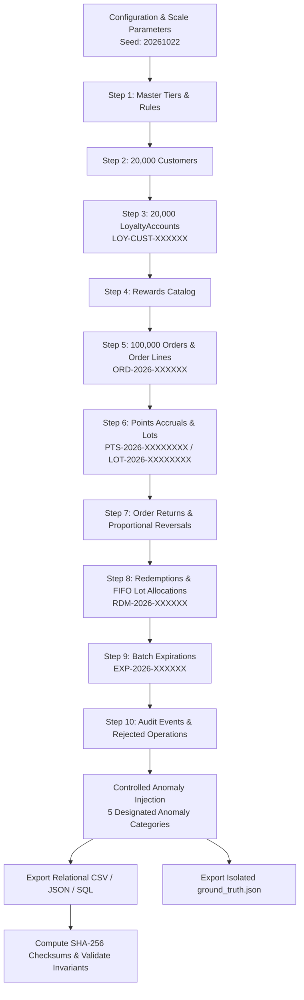

# 06. Deterministic Synthetic Data Generation Design

## 1. Generation Architecture & Objectives

The synthetic data generation framework for YottaFlex creates a realistic, mathematically reconciled, and reproducible enterprise loyalty dataset.



### Key Engineering Objectives:
1. **Deterministic Reproducibility**: Using seed `20261022`, repeated runs produce 100% identical outputs (row counts, IDs, timestamps, amounts, and SHA-256 hashes).
2. **Parameterized Scale**: Supports both a starter/development slice (e.g., 500 customers, 2,000 orders) and the full baseline volume (20,000 customers, 100,000 orders, 300,000 points transactions).
3. **Rigorous Parent-Child Integrity**: Zero foreign key violations; dependent records reference valid parent IDs generated earlier in the sequence.
4. **Calculated Derived Fields**: Balances, qualifying spend, and line-item totals are calculated from raw transaction events rather than being generated independently.
5. **Isolated Ground-Truth Labels**: Injected anomalies are documented strictly in an out-of-band `ground_truth.json` file. Zero anomaly labels leak into operational tables.

---

## 2. Target Scale and Data Distributions

### 2.1 Scale Configuration

| Parameter | Starter / Dev Slice (1%) | Full Baseline Dataset (100%) | Generation Logic |
|---|---|---|---|
| **Customers** | 200 | 20,000 | Deterministic faker names, emails, phones |
| **LoyaltyAccounts** | 200 | 20,000 | 1:1 mapping with Customers |
| **Tiers** | 4 | 4 | Bronze, Silver, Gold, Platinum |
| **Rules** | 6 | 6 | Standard, Double Points, Summer Promo, etc. |
| **Rewards** | 10 | 10 | Fixed rewards catalog (vouchers, gift cards) |
| **Orders** | 1,000 | 100,000 | Avg 5 orders per customer (Poisson distribution) |
| **OrderLines** | ~2,800 | ~280,000 | 1 to 6 items per order (Avg 2.8 lines/order) |
| **Points Transactions** | ~3,000 | 300,000 | Accruals, Redemptions, Reversals, Expirations |
| **PointsLots** | ~1,000 | ~100,000 | 1:1 provisioned for each order accrual |
| **Redemptions** | ~250 | ~25,000 | Executed by active customers with balance |
| **Order Returns** | ~60 | ~6,000 | ~6% return rate (full and partial) |
| **Expiry Batches** | 12 | 12 | Monthly scheduled batch runs |
| **Injected Anomalies**| 25 | 250 | 50 cases per each of the 5 categories |

### 2.2 Realistic Data Distributions

- **Customer Activity (Pareto 80/20 Distribution)**:
  - 20% of customers ("VIP / Power Shoppers") account for 60% of total orders.
  - 50% ("Regular Shoppers") account for 35% of orders.
  - 30% ("Occasional Shoppers") account for 5% of orders.
- **Order Basket Values (Log-Normal Distribution)**:
  - Mean basket size: \$85.00 USD.
  - Median basket size: \$65.00 USD.
  - Range: \$8.50 to \$1,850.00 USD.
- **Tier Distribution at Baseline Completion**:
  - Bronze (Level 1): ~65% of accounts.
  - Silver (Level 2): ~22% of accounts.
  - Gold (Level 3): ~10% of accounts.
  - Platinum (Level 4): ~3% of accounts.
- **Temporal Distribution**:
  - Simulated timeline spans **18 months** (from January 1, 2025 to June 30, 2026).
  - Enables natural testing of 365-day point expiration and rolling qualification windows.

---

## 3. ID Nomenclature & Formatting Standards

All generated primary and foreign keys follow strict, zero-padded identifier conventions:

| Entity | ID Format | Example | Regex Pattern |
|---|---|---|---|
| **Customer** | `CUST-XXXXXX` | `CUST-000042` | `^CUST-[0-9]{6}$` |
| **LoyaltyAccount** | `LOY-CUST-XXXXXX` | `LOY-CUST-000042` | `^LOY-CUST-[0-9]{6}$` |
| **Tier** | `TIER-<NAME>` | `TIER-BRONZE`, `TIER-GOLD` | `^TIER-[A-Z]+$` |
| **Rule** | `RULE-<NAME>` | `RULE-SUMMER-2026` | `^RULE-[A-Z0-9-]+$` |
| **Reward** | `RWD-XXXX` | `RWD-0001` | `^RWD-[0-9]{4}$` |
| **Order** | `ORD-YYYY-XXXXXX` | `ORD-2026-000001` | `^ORD-[0-9]{4}-[0-9]{6}$` |
| **OrderLine** | `ORDL-YYYY-XXXXXX-ZZ`| `ORDL-2026-000001-01` | `^ORDL-[0-9]{4}-[0-9]{6}-[0-9]{2}$` |
| **PointsTransaction**| `PTS-YYYY-XXXXXXXX` | `PTS-2026-00000001` | `^PTS-[0-9]{4}-[0-9]{8}$` |
| **PointsLot** | `LOT-YYYY-XXXXXXXX` | `LOT-2026-00000001` | `^LOT-[0-9]{4}-[0-9]{8}$` |
| **Redemption** | `RDM-YYYY-XXXXXX` | `RDM-2026-000001` | `^RDM-[0-9]{4}-[0-9]{6}$` |
| **ExpiryBatch** | `EXP-YYYY-XXXXXX` | `EXP-2026-000001` | `^EXP-[0-9]{4}-[0-9]{6}$` |
| **AuditEvent** | `AUD-YYYY-XXXXXXXX` | `AUD-2026-00000001` | `^AUD-[0-9]{4}-[0-9]{8}$` |

---

## 4. Sequential Generation Dependencies

To maintain absolute referential integrity, the generator executes in a strict 10-step topological sequence:

```
[1. Tiers & Rules] ──► [2. Customers] ──► [3. LoyaltyAccounts]
                              │
                              ▼
                     [4. Rewards Catalog]
                              │
                              ▼
                    [5. Orders & Lines]
                              │
                              ▼
         [6. Accruals (PTS) & Lots (LOT)]
            │                     │
            ▼                     ▼
 [7. Returns & Reversals]   [8. Redemptions & Allocations]
                                  │
                                  ▼
                         [9. Expiry Batches]
                                  │
                                  ▼
                     [10. System Audit Events]
```

1. **Step 1 — Master Tiers & Rules**: Generates 4 tier tiers and 6 promotional rules with fixed IDs and multipliers.
2. **Step 2 — Customers**: Generates 20,000 unique customer identities with deterministic seed-based names and emails.
3. **Step 3 — Loyalty Accounts**: Provisions `LOY-<customer_id>` for each customer with 0 initial balance and default Bronze tier.
4. **Step 4 — Rewards Catalog**: Generates 10 fixed rewards ranging from \$5 coupons (500 pts) to \$100 vouchers (10,000 pts).
5. **Step 5 — Orders & Order Lines**: Generates 100,000 orders distributed chronologically across customers; computes net spend, taxes, and shipping per line.
6. **Step 6 — Points Accrual & Lots**: For each completed order, calculates points using customer's tier at order date; generates `PointsTransaction` (`ACCRUAL`) and `PointsLot` with `expires_at = order_date + 365 days`.
7. **Step 7 — Order Returns & Points Reversals**: Selects ~6% of orders for returns (4% full returns, 2% partial returns); generates `OrderReturn` and linked `PointsTransaction` (`REVERSAL`) referencing original accrual.
8. **Step 8 — Redemptions & FIFO Lot Allocations**: Simulates customer redemptions using available points; allocates deductions across active unexpired lots in FIFO order; creates `Redemption`, `PointsTransaction` (`REDEMPTION`), and `PointsLotAllocation` records.
9. **Step 9 — Expiry Batches**: Simulates monthly batch expiration jobs for lots whose `expires_at` has passed; generates `ExpiryBatch`, `ExpiryBatchItem`, and ledger debits (`EXPIRY`).
10. **Step 10 — Audit Events**: Generates corresponding `AuditEvent` records for all significant state transitions.

---

## 5. Injected Anomaly Design & Ground Truth

To validate the **Loyalty Ledger Intelligence & Reconciliation Engine**, the generator creates a 100% mathematically valid baseline, and then injects **250 controlled anomalies** (50 instances across each of the 5 required categories).

### 5.1 Anomaly Categories and Injection Mechanics

```
┌─────────────────────────────────────────────────────────────────────────────┐
│                       5 INJECTED ANOMALY CATEGORIES                         │
├──────────────────────────┬──────────────────────────┬───────────────────────┤
│ 1. BALANCE_LEDGER_MISMATCH│ 2. OVER_REDEMPTION       │ 3. RETURN_WITHOUT_    │
│ Desynchronizes cached     │ Forces a redemption      │    REVERSAL           │
│ balance from the true     │ transaction exceeding    │ Marks order returned  │
│ sum of ledger entries.    │ total available points.  │ without creating      │
│ Target: 50 accounts.      │ Target: 50 redemptions.  │ reversal ledger debit.│
│                          │                          │ Target: 50 orders.    │
├──────────────────────────┴──────────────────────────┼───────────────────────┤
│ 4. DOUBLE_EXPIRATION                                │ 5. GROSS_SPEND_TIER_  │
│ Creates duplicate ledger debit entries for the      │    CALCULATION        │
│ same expired points lot.                            │ Assigns higher tier   │
│ Target: 50 points lots.                             │ using gross spend.    │
│                                                     │ Target: 50 accounts.  │
└─────────────────────────────────────────────────────┴───────────────────────┘
```

#### Category 1: `BALANCE_LEDGER_MISMATCH`
- **Mechanism**: Modifies `LoyaltyAccount.current_balance` directly without creating a ledger transaction (simulating a direct database update bug or unsynced write).
- **Target**: 50 randomly selected accounts.
- **Injected Variance**: $\pm 50$ to $\pm 500$ points.

#### Category 2: `OVER_REDEMPTION`
- **Mechanism**: Inserts a `REDEMPTION` transaction and voucher for a customer whose available balance is less than the requested amount (simulating a bypassed balance check).
- **Target**: 50 transactions.
- **Deficit**: 100 to 1,000 points into negative territory without a corresponding return.

#### Category 3: `RETURN_WITHOUT_REVERSAL`
- **Mechanism**: Creates an `OrderReturn` record marking merchandise returned and refunded, but suppresses the execution of Workflow F (omits the `REVERSAL` entry in `PointsTransaction`).
- **Target**: 50 returned orders.
- **Impact**: Customer unlawfully retains unearned points from returned goods.

#### Category 4: `DOUBLE_EXPIRATION`
- **Mechanism**: Generates two distinct `EXPIRY` ledger transactions referencing the same `PointsLot`, debiting the customer's balance twice for the same expired points.
- **Target**: 50 points lots.
- **Impact**: Customer unfairly penalized by duplicate expiration debits.

#### Category 5: `GROSS_SPEND_TIER_CALCULATION`
- **Mechanism**: Assigns an upgraded tier (e.g., Gold or Platinum) to an account based on `Gross Spend` (including \$250 tax/shipping) when their `Qualifying Spend` is below the threshold.
- **Target**: 50 accounts.
- **Impact**: Customer granted inflated tier earning multipliers unfairly.

### 5.2 Strict Ground-Truth Isolation

All injected anomaly details are written exclusively to an isolated **`ground_truth.json`** file formatted as follows:

```json
[
  {
    "anomaly_id": "GT-ANOMALY-0001",
    "issue_type": "BALANCE_LEDGER_MISMATCH",
    "entity_id": "LOY-CUST-001248",
    "entity_type": "LoyaltyAccount",
    "injected_variance": -250,
    "actual_ledger_sum": 750,
    "corrupted_cached_balance": 500,
    "violated_rule": "BR-02 / Ledger Reconciliation Invariant",
    "injection_timestamp": "2026-04-12T10:15:00Z"
  }
]
```

**Security Invariant**: The operational schema (`loyalty_accounts`, `points_transactions`, etc.) contains zero columns indicating anomaly status. The anomaly detection engine runs completely blind to `ground_truth.json`.

---

## 6. Verification & Quality Assurance Pipeline

The generated dataset undergoes 7 automated integrity checks prior to acceptance:

```
[ Generated Raw Data ]
         │
         ├──► 1. Primary Key Uniqueness Test (Assert len(PK) == len(set(PK)))
         ├──► 2. Foreign Key Integrity Test (Assert all FKs exist in parent table)
         ├──► 3. Date Sequence Chronology Test (Assert order_date <= return_date)
         ├──► 4. Arithmetic Spend Reconciliation (Assert net = gross - tax - ship)
         ├──► 5. Points Lot Sum Reconciliation (Assert remaining <= initial)
         ├──► 6. Reproducibility Check (Compare SHA-256 across dual runs)
         └──► 7. Ground Truth Coverage Verification (Assert 250 anomalies documented)
```

### Reproducibility Verification Protocol:
1. Run generator with `SEED=20261022` and output to directory `data/run1/`.
2. Compute SHA-256 hashes of all exported CSVs: `sha256sum data/run1/*.csv`.
3. Run generator with `SEED=20261022` and output to directory `data/run2/`.
4. Compute SHA-256 hashes of second run: `sha256sum data/run2/*.csv`.
5. Execute automated diff: `diff -r data/run1/ data/run2/`.
6. Acceptance requires **zero diff** and identical file checksums.
