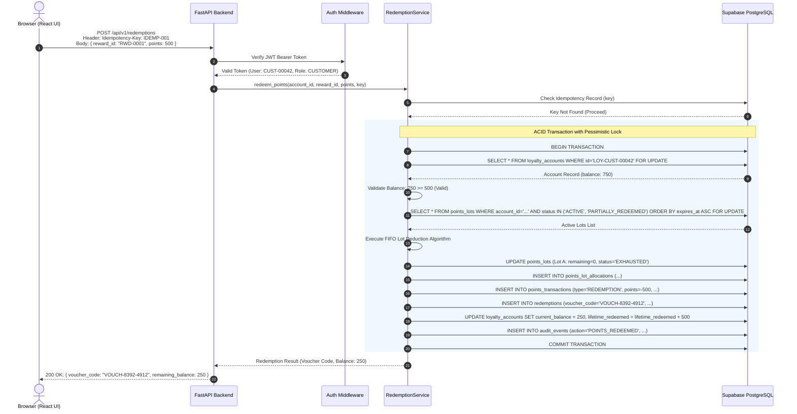

# 07. System Architecture and Three-Tier Engineering Design

## 1. High-Level Architectural Overview

The YottaFlex loyalty platform is designed as a strict **Three-Tier Architecture** ensuring high cohesion, loose coupling, complete separation of concerns, and robust security boundaries.

```mermaid
flowchart TD
    subgraph PresentationTier ["PRESENTATION TIER (Client / Browser)"]
        UI_Cust["Customer Portal<br>(Balance, Ledger, Rewards)"]
        UI_Op["Store Operator Desk<br>(Orders, Returns, Vouchers)"]
        UI_An["Analyst Dashboard<br>(Tiers, Rules, Liabilities)"]
        UI_Mgr["Ops Manager Console<br>(Reconciliation, Approvals)"]
    end

    subgraph AppTier ["APPLICATION TIER (FastAPI Backend)"]
        AuthMid["Auth & RBAC Middleware<br>(Supabase JWT / Firebase ID Token)"]
        
        subgraph Services ["Core Business Services Layer"]
            AccrualSvc["Accrual Service<br>(Net Spend, Multipliers)"]
            RedeemSvc["Redemption Service<br>(FIFO Lots, Pessimistic Lock)"]
            ReversalSvc["Reversal Service<br>(Proportional Return Links)"]
            ExpirySvc["Expiry Service<br>(Idempotent Batch Runner)"]
            TierSvc["Tier Service<br>(Qualifying Spend Progression)"]
            ReconcileSvc["Reconciliation & Anomaly Engine<br>(Forensics & Corrective Actions)"]
            AuditSvc["Audit & Decision Logger"]
        end

        RepoLayer["Repository / Data Access Layer<br>(SQLAlchemy / AsyncPG)"]
    end

    subgraph DataTier ["DATA TIER (Supabase PostgreSQL)"]
        MasterDB["Master Tables<br>(Customers, Tiers, Rules, Orders)"]
        LedgerDB["Append-Only Ledger<br>(PointsTransaction, PointsLot)"]
        AuditDB["Audit & Decision Store<br>(AuditEvents, RejectedOps)"]
        RLS["PostgreSQL Row-Level Security & Triggers"]
    end

    PresentationTier -->|HTTPS / REST API / Bearer JWT| AuthMid
    AuthMid --> Services
    Services --> RepoLayer
    RepoLayer -->|Async Connection Pool| DataTier
```

---

## 2. Tier Responsibilities & Isolation Boundaries

### 2.1 Presentation Tier
- **Technology Stack**: React 18, TypeScript, Vite, Tailwind CSS, Lucide React, TanStack Query, React Router v6.
- **Architectural Responsibilities**:
  1. Render role-tailored user interfaces for Customer, Operator, Analyst, and Operations Manager.
  2. Handle client-side routing, page navigation, and authentication redirect guards.
  3. Perform immediate client-side form validation (email format, positive point numbers).
  4. Manage optimistic UI feedback, loading spinners, and standardized error toast notifications.
  5. Visualize financial and operational metrics using interactive charts (balance trends, liability charts, anomaly distribution).
  6. Generate and send client `Idempotency-Key` headers for all state-changing requests.
- **Strict Boundary Rule**: **Zero Business Logic in the Frontend**. The frontend never calculates points earned, never decrements points balances, never evaluates tier qualification, and never determines reversal amounts. All domain logic resides strictly in the Application Tier.

### 2.2 Application / Business Logic Tier
- **Technology Stack**: Python 3.14, FastAPI, Pydantic v2, SQLAlchemy 2.0 (Async), Uvicorn, Structlog.
- **Architectural Responsibilities**:
  1. **Authentication Verification**: Verify cryptographic signatures of Supabase access tokens and Firebase ID tokens.
  2. **Role-Based Authorization (RBAC)**: Enforce route-level permission checks across Customer, Operator, Analyst, and Operations Manager roles.
  3. **Business Rules Execution**:
     - Compute eligible net spend from order lines.
     - Apply tier multipliers, promotional rules, and floor rounding.
     - Evaluate qualifying spend within rolling qualification windows.
     - Execute atomic redemptions and allocate deductions across FIFO lots.
     - Calculate proportional reversals and enforce the original accrual ceiling.
  4. **Concurrency & Transaction Control**: Wrap all multi-step state mutations inside ACID database transactions with row-level locks (`SELECT ... FOR UPDATE`).
  5. **Idempotency Protection**: Manage idempotency keys to ensure network retries do not produce duplicate transactions.
  6. **Reconciliation & Anomaly Detection**: Execute automated forensic scans, compute variance magnitude, and prepare corrective action plans.
  7. **Audit & Decision Trail**: Emit structured `AuditEvent` records and capture failed attempts in `RejectedOperation`.
  8. **API Validation & Error Handling**: Validate incoming JSON contracts via Pydantic schemas; return standardized RFC-7807 problem details.

### 2.3 Data Tier
- **Technology Stack**: Supabase PostgreSQL 15+, PL/pgSQL, PostgreSQL Extensions (`pgcrypto`, `uuid-ossp`).
- **Architectural Responsibilities**:
  1. **Relational Persistence**: Store all master, transaction, lot, and audit records with strict data types.
  2. **Relational Constraints**: Enforce foreign keys with `ON DELETE RESTRICT`, unique constraints on email and idempotency keys, and check constraints (`remaining_points >= 0`).
  3. **Immutability Enforcement**: Database triggers (`BEFORE UPDATE OR DELETE ON points_transactions`) prevent modification or deletion of financial ledger entries.
  4. **Performance Indexing**: Optimized composite B-tree indexes supporting FIFO lot allocation queries, ledger balance sums, and customer order histories.
  5. **Row-Level Security (RLS)**: Enforce database-level data isolation ensuring customers can only access their own records when connecting via Supabase client libraries.

---

## 3. Component & Service Architecture

```mermaid
classDiagram
    class AccrualService {
        +calculate_eligible_net_spend(order_lines)
        +calculate_points(net_spend, tier, rules)
        +accrue_points(account_id, order_id, points, idempotency_key)
    }

    class RedemptionService {
        +validate_redemption(account_id, requested_points)
        +allocate_fifo_lots(account_id, requested_points)
        +redeem_points(account_id, reward_id, points, idempotency_key)
    }

    class ReversalService {
        +calculate_proportional_reversal(order, returned_lines)
        +validate_reversal_ceiling(accrual_pts, requested_reversal)
        +reverse_points(return_id, points, idempotency_key)
    }

    class ExpiryService {
        +find_expired_lots(cutoff_date)
        +process_expiry_batch(cutoff_date, batch_size)
    }

    class TierService {
        +calculate_qualifying_spend(account_id, window_days)
        +evaluate_tier_upgrade(account_id)
        +evaluate_annual_downgrade(account_id)
    }

    class ReconciliationService {
        +scan_balance_ledger_mismatch()
        +scan_over_redemptions()
        +scan_unreversed_returns()
        +scan_double_expirations()
        +scan_gross_spend_tier_anomalies()
        +propose_corrective_action(incident_id)
        +execute_approved_action(action_id, operator_id)
    }

    class LedgerRepository {
        +get_account_balance(account_id)
        +get_ledger_sum(account_id)
        +append_transaction(entry)
        +get_active_lots_fifo(account_id)
        +update_lot_remaining(lot_id, remaining, status)
    }

    AccrualService --> LedgerRepository
    RedemptionService --> LedgerRepository
    ReversalService --> LedgerRepository
    ExpiryService --> LedgerRepository
    ReconciliationService --> LedgerRepository
    TierService --> LedgerRepository
```

---

## 4. End-to-End API Interaction Flow

The sequence below illustrates the complete three-tier interaction during a points redemption:

---

## 5. Security & Isolation Guidelines

1. **Service Layer Isolation**: All database queries must be mediated by the service/repository layer. API route handlers only handle HTTP status codes, deserialization, and dependency injection.
2. **Safe Transaction Scoping**: Database connections and sessions are scoped per request (`get_db_session` dependency) and closed immediately after response dispatch.
3. **No Direct Schema Access from Presentation**: The frontend never connects directly to database connection strings or executes raw SQL queries. All interactions flow through the authenticated REST API.
