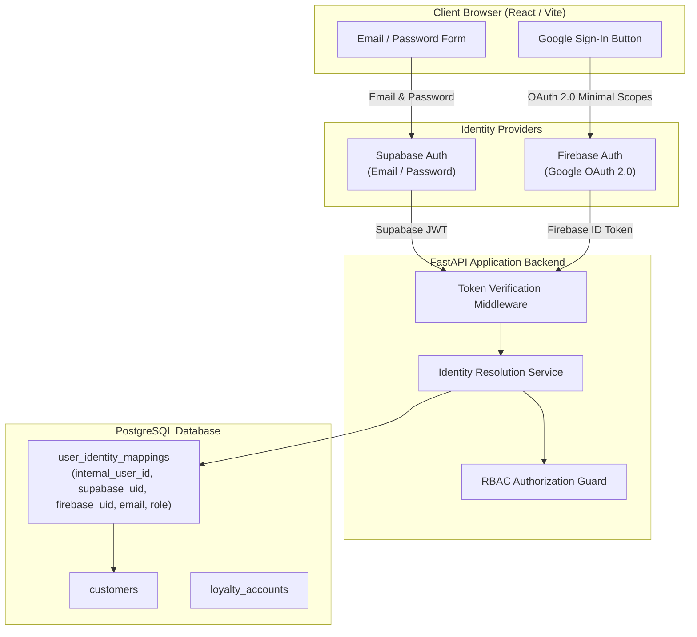

# 08. Authentication, Unified Identity, and Security Architecture

## 1. Unified Identity Model

The YottaFlex platform integrates two distinct identity providers into a single, unified enterprise security architecture:
1. **Supabase Auth**: Primary provider for standard Email & Password registration, password reset flows, and session refresh.
2. **Firebase Auth**: Dedicated OAuth provider for Google Sign-In and Google Sign-Up.



---

## 2. Identity Mapping & Account Resolution Schema

To eliminate tight coupling to any single authentication vendor, the system maps external provider UIDs to an internal `internal_user_id`:

### `user_identity_mappings` Table Definition
```sql
CREATE TABLE user_identity_mappings (
    mapping_id UUID PRIMARY KEY DEFAULT gen_random_uuid(),
    internal_user_id VARCHAR(32) NOT NULL UNIQUE,
    customer_id VARCHAR(32) NOT NULL UNIQUE REFERENCES customers(customer_id) ON DELETE RESTRICT,
    supabase_uid UUID UNIQUE,
    firebase_uid VARCHAR(128) UNIQUE,
    primary_email VARCHAR(255) NOT NULL,
    email_verified BOOLEAN NOT NULL DEFAULT FALSE,
    auth_provider VARCHAR(30) NOT NULL CHECK (auth_provider IN ('SUPABASE_PASSWORD', 'FIREBASE_GOOGLE')),
    role VARCHAR(30) NOT NULL DEFAULT 'CUSTOMER' 
        CHECK (role IN ('CUSTOMER', 'OPERATOR', 'ANALYST', 'OPERATIONS_MANAGER')),
    account_status VARCHAR(20) NOT NULL DEFAULT 'ACTIVE' 
        CHECK (account_status IN ('ACTIVE', 'SUSPENDED', 'CLOSED')),
    created_at TIMESTAMPTZ NOT NULL DEFAULT NOW(),
    updated_at TIMESTAMPTZ NOT NULL DEFAULT NOW()
);

CREATE INDEX idx_user_mappings_email ON user_identity_mappings(primary_email);
CREATE INDEX idx_user_mappings_supabase ON user_identity_mappings(supabase_uid) WHERE supabase_uid IS NOT NULL;
CREATE INDEX idx_user_mappings_firebase ON user_identity_mappings(firebase_uid) WHERE firebase_uid IS NOT NULL;
```

---

## 3. Strict Security Invariants & Zero-Trust Policies

### 3.1 Server-Side Cryptographic Token Verification
- **Zero Frontend Trust**: The backend never accepts or trusts client-supplied `user_id`, `customer_id`, or `email` fields in request bodies or query parameters.
- **Header Requirement**: All authenticated API calls must transmit a `Bearer <token>` in the HTTP `Authorization` header.
- **Verification Logic**:
  ```python
  async def get_current_user(token: str = Depends(oauth2_scheme)) -> AuthenticatedUser:
      # Step 1: Attempt Supabase JWT verification
      try:
          payload = jwt.decode(token, SUPABASE_JWT_SECRET, algorithms=["HS256"], audience="authenticated")
          uid = payload.get("sub")
          email = payload.get("email")
          return await resolve_identity(supabase_uid=uid, email=email)
      except JWTError:
          pass

      # Step 2: Attempt Firebase ID Token verification
      try:
          decoded_token = auth.verify_id_token(token, check_revoked=True)
          uid = decoded_token.get("uid")
          email = decoded_token.get("email")
          email_verified = decoded_token.get("email_verified", False)
          return await resolve_identity(firebase_uid=uid, email=email, email_verified=email_verified)
      except Exception as e:
          raise HTTPException(status_code=401, detail="Invalid or expired authentication credentials")
  ```

### 3.2 Anti-Account Hijacking & Account Linking Policy
- **No Automatic Email Merging**: The backend **never** merges an existing Supabase email/password account with an incoming Firebase Google account simply because the email addresses match. Automatic merging creates an account takeover vulnerability if a malicious user creates a third-party account with an unverified victim email.
- **Safe Linking Workflow**:
  1. If a Google sign-in occurs with an email matching an existing Supabase account:
  2. The system checks `firebase_token.email_verified == TRUE`.
  3. If unverified, linking is rejected.
  4. If verified, the system requires the user to authenticate against their existing account (entering their password once) before linking the `firebase_uid` to the existing `internal_user_id`.

### 3.3 Secret & Credential Protection
- **Zero Secrets in Frontend Code**:
  - The client application bundle contains only public identifiers: `VITE_SUPABASE_URL`, `VITE_SUPABASE_ANON_KEY`, and `VITE_FIREBASE_CONFIG` (web client ID).
  - High-privilege secrets (`SUPABASE_SERVICE_ROLE_KEY`, `SUPABASE_JWT_SECRET`, `FIREBASE_ADMIN_CREDENTIALS`, `DATABASE_URL`) are strictly confined to the backend server environment variables (`.env`).
  - Frontend bundle code analysis during Phase 7 QA explicitly verifies zero presence of service-role keys or private credentials.

### 3.4 Minimal OAuth Scopes
- When initiating Google Sign-In via Firebase Auth, the requested OAuth 2.0 scopes are strictly restricted to:
  - `openid`
  - `https://www.googleapis.com/auth/userinfo.email`
  - `https://www.googleapis.com/auth/userinfo.profile`
- The application **never** requests access to Gmail, Google Drive, Google Contacts, or other sensitive Google Workspace APIs.

---

## 4. Role-Based Access Control (RBAC) Matrix

The system enforces four distinct roles with strict permission boundaries:

| Resource / Action | Customer | Store Operator | E-commerce Analyst | Operations Manager |
|---|:---:|:---:|:---:|:---:|
| **View Own Balance & Ledger History** | Allowed | Allowed | Allowed | Allowed |
| **Browse Rewards & Redeem Points** | Allowed | Blocked | Blocked | Blocked |
| **View Other Customer Profiles / Ledgers** | Blocked | Allowed | Allowed | Allowed |
| **Process Orders & Incur Accruals** | Blocked | Allowed | Blocked | Blocked |
| **Process Returns & Reversals** | Blocked | Allowed | Blocked | Blocked |
| **Configure Tiers & Multiplier Rules** | Blocked | Blocked | Allowed | Allowed |
| **View Liability & Breakage Reports** | Blocked | Blocked | Allowed | Allowed |
| **Trigger Batch Expiry Jobs** | Blocked | Blocked | Blocked | Allowed |
| **Execute Automated Reconciliation Scans**| Blocked | Blocked | Allowed (Read) | Allowed (Run) |
| **Approve Corrective Action Adjustments** | Blocked | Blocked | Blocked | Allowed |

---

## 5. PostgreSQL Row-Level Security (RLS) Policies

To implement defense-in-depth, PostgreSQL Row-Level Security policies are applied directly at the database tier:

```sql
-- Enable RLS on core tables
ALTER TABLE customers ENABLE ROW LEVEL SECURITY;
ALTER TABLE loyalty_accounts ENABLE ROW LEVEL SECURITY;
ALTER TABLE points_transactions ENABLE ROW LEVEL SECURITY;
ALTER TABLE points_lots ENABLE ROW LEVEL SECURITY;
ALTER TABLE redemptions ENABLE ROW LEVEL SECURITY;

-- Customer can only SELECT their own customer profile
CREATE POLICY customer_read_own ON customers
    FOR SELECT
    USING (customer_id = current_setting('request.jwt.claim.customer_id', true));

-- Customer can only view their own loyalty account
CREATE POLICY account_read_own ON loyalty_accounts
    FOR SELECT
    USING (customer_id = current_setting('request.jwt.claim.customer_id', true));

-- Customer can only view their own ledger transactions
CREATE POLICY ledger_read_own ON points_transactions
    FOR SELECT
    USING (account_id = (
        SELECT account_id FROM loyalty_accounts 
        WHERE customer_id = current_setting('request.jwt.claim.customer_id', true)
    ));

-- Staff roles bypass customer-level restrictions via service role or staff role claims
CREATE POLICY staff_all ON points_transactions
    FOR ALL
    USING (current_setting('request.jwt.claim.role', true) IN ('OPERATOR', 'ANALYST', 'OPERATIONS_MANAGER'));
```

---

## 6. Public Web Application Page Blueprints

The frontend application provides the following 7 core pages and navigation architecture:

```
┌─────────────────────────────────────────────────────────────────────────────┐
│                          APPLICATION PAGE BLUEPRINTS                        │
├─────────────────────┬───────────────────────────────────────────────────────┤
│ 1. Home             │ Public landing page introducing the YottaFlex loyalty │
│    (/)              │ program, tier benefits, earning rates, and catalog.   │
├─────────────────────┼───────────────────────────────────────────────────────┤
│ 2. About            │ Transparent explanation of points value, expiration   │
│    (/about)         │ rules (365 days), and auditable ledger principles.    │
├─────────────────────┼───────────────────────────────────────────────────────┤
│ 3. Sign In          │ Dual login form: Email/Password (Supabase) +          │
│    (/sign-in)       │ "Continue with Google" button (Firebase).             │
├─────────────────────┼───────────────────────────────────────────────────────┤
│ 4. Sign Up          │ Registration with validation, terms acceptance, and   │
│    (/sign-up)       │ automatic loyalty account provisioning.               │
├─────────────────────┼───────────────────────────────────────────────────────┤
│ 5. Forgot Password  │ Self-service password reset request via Supabase Auth │
│    (/forgot-password) secure email link.                                    │
├─────────────────────┼───────────────────────────────────────────────────────┤
│ 6. Dashboard        │ Role-aware landing console:                           │
│    (/dashboard)     │ - Customer: Balance, tier progress, points expiring,  │
│                     │   recent transactions, and quick-redeem buttons.      │
│                     │ - Operator: Return scanner and order reversal tool.   │
│                     │ - Analyst: Liability breakdown, breakage velocity.    │
│                     │ - Ops Manager: Anomaly console & reconciliation hub.  │
├─────────────────────┼───────────────────────────────────────────────────────┤
│ 7. Profile /        │ User profile management, linked identities (Google/   │
│    Settings         │ Password), security logs, and notification preferences│
│    (/settings)      │                                                       │
└─────────────────────┴───────────────────────────────────────────────────────┘
```
