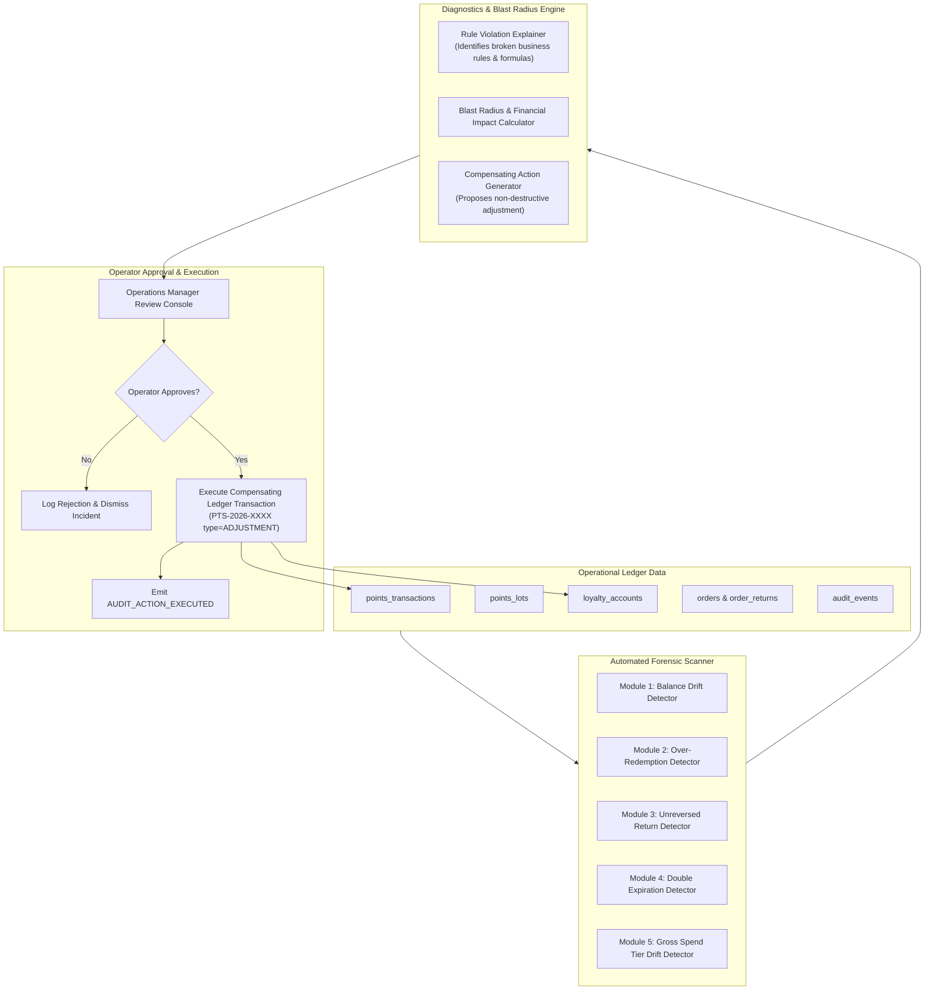

# 09. Innovation Feature & Measurable Evaluation Framework

## 1. Innovation Feature: Loyalty Ledger Intelligence & Reconciliation Engine (LLIRE)

### 1.1 Business Value Justification vs Decorative Features
In enterprise loyalty management, loyalty points represent active balance sheet liabilities (e.g., millions of dollars in unredeemed points liability). Financial regulators (ASC 606 / IFRS 15) mandate strict revenue recognition standards for customer loyalty programs. 

Conventional applications often resort to "decorative AI" features (e.g., generic chatbot widgets that answer FAQ questions) that provide zero tangible financial or operational impact. In contrast, the **Loyalty Ledger Intelligence & Reconciliation Engine (LLIRE)** delivers mission-critical enterprise value:
1. **Preventing Financial Leakage**: Immediately halts phantom liabilities caused by balance drift, over-redemption, or unreversed returns.
2. **Regulatory & Audit Readiness**: Provides automated mathematical proof of ledger integrity for corporate auditors.
3. **Dual-Key Human-in-the-Loop Governance**: Prevents runaway automated data mutations by requiring explicit human operator review and cryptographic audit sign-off for corrective actions.
4. **Non-Destructive Ledger Preservation**: Enforces accounting standards by resolving variances exclusively through compensating entries (`ADJUSTMENT_CREDIT`, `ADJUSTMENT_DEBIT`), leaving the original audit history 100% intact.

---

## 2. LLIRE Architecture & Forensic Scanner Modules



---

## 3. The 5 Core Forensic Detection Modules

### Module 1: Balance vs Ledger Sum Mismatch Detector
- **Target Anomaly**: `BALANCE_LEDGER_MISMATCH`
- **Detection Algorithm**:
  ```sql
  SELECT 
      a.account_id,
      a.current_balance AS cached_balance,
      COALESCE(SUM(CASE 
          WHEN t.entry_type IN ('ACCRUAL', 'ADJUSTMENT_CREDIT') THEN t.points
          WHEN t.entry_type IN ('REDEMPTION', 'REVERSAL', 'EXPIRY', 'ADJUSTMENT_DEBIT') THEN -t.points
          ELSE 0 END), 0) AS computed_ledger_sum,
      (a.current_balance - COALESCE(SUM(...), 0)) AS variance
  FROM loyalty_accounts a
  LEFT JOIN points_transactions t ON a.account_id = t.account_id
  GROUP BY a.account_id, a.current_balance
  HAVING a.current_balance != COALESCE(SUM(...), 0);
  ```
- **Diagnostic Explanation**: Explains that the account balance was updated outside the ledger journal (e.g., direct database update or lost write).
- **Proposed Correction**: Generates a compensating `ADJUSTMENT_CREDIT` (if ledger sum > cached balance) or `ADJUSTMENT_DEBIT` (if ledger sum < cached balance) to synchronize the cached balance with the immutable ledger.

### Module 2: Over-Redemption & Overdraft Detector
- **Target Anomaly**: `OVER_REDEMPTION`
- **Detection Algorithm**:
  - Identifies accounts where a redemption transaction was accepted despite insufficient cumulative points credits at the time of redemption, or accounts where cumulative redemptions exceed lifetime accruals without a corresponding return.
- **Diagnostic Explanation**: Highlights the redemption transaction ID, requested point count, and the point deficit at the execution timestamp.
- **Proposed Correction**: Freezes account redemption capabilities and generates an alert for potential checkout fraud or concurrency bypass.

### Module 3: Unreversed Return Detector
- **Target Anomaly**: `RETURN_WITHOUT_REVERSAL`
- **Detection Algorithm**:
  ```sql
  SELECT 
      r.return_id,
      r.order_id,
      r.total_refund_amount,
      o.customer_id,
      orig_pts.points AS original_accrual_points
  FROM order_returns r
  JOIN orders o ON r.order_id = o.order_id
  JOIN points_transactions orig_pts ON o.order_id = orig_pts.order_id 
      AND orig_pts.entry_type = 'ACCRUAL'
  LEFT JOIN points_transactions rev_pts ON o.order_id = rev_pts.order_id 
      AND rev_pts.entry_type = 'REVERSAL'
  WHERE rev_pts.transaction_id IS NULL;
  ```
- **Diagnostic Explanation**: Indicates that order items were refunded and returned, but points awarded were never deducted from the customer's loyalty account.
- **Proposed Correction**: Calculates the exact proportional points to reverse and queues an approved `REVERSAL` ledger entry referencing the original accrual transaction.

### Module 4: Double Expiration Detector
- **Target Anomaly**: `DOUBLE_EXPIRATION`
- **Detection Algorithm**:
  ```sql
  SELECT 
      l.lot_id,
      l.account_id,
      COUNT(t.transaction_id) AS expiry_transaction_count,
      SUM(t.points) AS total_points_debited
  FROM points_lots l
  JOIN points_transactions t ON l.lot_id = t.lot_id AND t.entry_type = 'EXPIRY'
  GROUP BY l.lot_id, l.account_id
  HAVING COUNT(t.transaction_id) > 1;
  ```
- **Diagnostic Explanation**: Flags duplicate execution of batch expiry jobs against the same lot, resulting in an unlawful duplicate debit.
- **Proposed Correction**: Creates a compensating `ADJUSTMENT_CREDIT` transaction to reimburse the customer for the second duplicate expiry debit.

### Module 5: Gross Spend Tier Calculation Drift Detector
- **Target Anomaly**: `GROSS_SPEND_TIER_CALCULATION`
- **Detection Algorithm**:
  - Re-evaluates each customer's tier based on `Qualifying Spend` (excluding taxes, shipping, discounts, and returned goods) within the rolling 365-day window.
  - Compares the qualified tier against `LoyaltyAccount.tier_id`.
  - Flags accounts where the assigned tier is higher than the qualifying spend justifies, indicating gross spend was used instead of net eligible spend.
- **Diagnostic Explanation**: Details the difference between customer gross spend (e.g., \$1,050 including taxes/shipping) and qualifying spend (\$950), demonstrating that the customer was prematurely awarded Gold status.
- **Proposed Correction**: Updates account tier to Silver and adjusts future earning rates to prevent points inflation.

---

## 4. Measurable Evaluation Framework

To maintain engineering discipline and prevent fabricated claims, all performance, throughput, and accuracy metrics are defined with precise benchmarking procedures.

### 4.1 Evaluation Benchmark Metrics Table

| Metric Category | Specific Benchmark Metric | Target Threshold | Measurement Methodology |
|---|---|---|---|
| **Data Generation** | Full dataset generation runtime (20k cust, 100k orders, 300k pts) | $< 180$ seconds | Python `time.perf_counter()` from generator start to CSV completion. |
| **Data Ingestion** | Database bulk ingestion runtime | $< 120$ seconds | `psql \copy` or async batch insert benchmark. |
| **Accrual Performance** | Order accrual P95 latency under load | $< 50$ ms | API load test measuring request-to-response duration. |
| **Redemption Performance**| Atomic FIFO redemption P95 latency | $< 100$ ms | Concurrent load test measuring row-lock and allocation duration. |
| **Reversal Performance** | Order return reversal P95 latency | $< 60$ ms | Automated test simulating partial and full return calls. |
| **Expiry Throughput** | Batch expiry processing velocity | $\ge 1,000$ lots/sec | Timed execution of `process_expiry_batch` across 10,000 lots. |
| **Reconciliation Runtime**| Full ledger reconciliation scan (300k txs) | $< 30$ seconds | Single execution of the 5 forensic SQL queries across full dataset. |
| **Ledger Consistency** | Mathematical balance reconciliation rate | 100.0% | Zero unexplained variances on baseline accounts. |
| **Anomaly Precision** | Anomaly detection Precision ($TP / (TP + FP)$) | $1.00$ (100%) | Automated evaluation against out-of-band `ground_truth.json`. |
| **Anomaly Recall** | Anomaly detection Recall ($TP / (TP + FN)$) | $\ge 0.98$ (98%) | Automated evaluation against out-of-band `ground_truth.json`. |
| **Decision Capture** | Rejected operations capture percentage | 100.0% | Assert `len(RejectedOperation) == len(attempted_invalid_requests)`. |

---

## 5. Anomaly Detection Precision & Recall Mathematical Formulation

Let:
- $G$ be the set of anomalies documented in `ground_truth.json` ($|G| = 250$).
- $D$ be the set of anomaly incidents flagged by the LLIRE forensic scanner.
- $TP = |D \cap G|$ (True Positives: correctly flagged injected anomalies).
- $FP = |D \setminus G|$ (False Positives: erroneously flagged valid transactions).
- $FN = |G \setminus D|$ (False Negatives: injected anomalies missed by scanner).

The evaluation script executes the following automated verification:
$$\text{Precision} = \frac{TP}{TP + FP}, \quad \text{Recall} = \frac{TP}{TP + FN}, \quad F_1 = 2 \times \frac{\text{Precision} \times \text{Recall}}{\text{Precision} + \text{Recall}}$$

Target Acceptance:
- $\text{Precision} = 1.00$ (Zero false accusations against legitimate customer accounts).
- $\text{Recall} \ge 0.98$ (Detects at least 245 of the 250 injected anomalies across all 5 classes).
