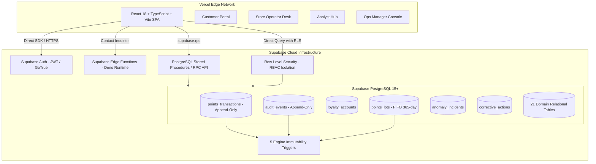

# LoyaltyOS — System Architecture

**Product Name:** LoyaltyOS — Intelligent Loyalty & Ledger Management Platform  
**Repository:** https://github.com/dandetejaswini/LoyaltyOS  
**Core Purpose:** Financial-grade loyalty ledger, automated anomaly detection (LLIRE), and dual-key remediation.

---

## 1. System Overview

LoyaltyOS is built with a **100% Supabase-native architecture**. All transactional business logic, financial ledger operations, audit controls, and dual-key remediation execute directly within Supabase PostgreSQL using Stored Procedures (RPC), Database Engine Triggers, and Row-Level Security (RLS). The frontend is a modern React 18 + Vite SPA deployed globally to Vercel's Edge Network.



---

## 2. Complete Backend Migration Matrix

Every production capability previously served by an intermediary Python server has been migrated directly to Supabase:

| Previous Python Endpoint | Supabase Replacement Method | Type / Mechanism | Operational Role |
| :--- | :--- | :--- | :--- |
| `POST /api/v1/auth/provision` | `fn_provision_customer` | PostgreSQL RPC | Customer & Loyalty Account Creation |
| `GET /api/v1/auth/me` | `fn_get_my_profile` | PostgreSQL RPC | Authenticated Profile Resolution |
| `GET /api/v1/accounts/{id}` | `supabase.from('loyalty_accounts')` | Direct Query (RLS) | Balance & Account Information |
| `POST /api/v1/orders/accrue` | `fn_accrue_order_points` | PostgreSQL RPC | Floor-rounded Accrual & FIFO Lot Creation |
| `POST /api/v1/redemptions` | `fn_redeem_reward` | PostgreSQL RPC | Concurrency Lock (`FOR UPDATE`) & Lot Allocation |
| `POST /api/v1/returns` | `fn_process_order_return` | PostgreSQL RPC | Proportional Points Reversal & Negative Balance |
| `POST /api/v1/reconciliation/run` | `fn_reconcile_account` | PostgreSQL RPC | 3-Way Invariant Math Engine |
| `POST /api/v1/expiry/execute` | `fn_expire_points_lots` | PostgreSQL RPC | Idempotent Expiration Batch Run |
| `POST /api/v1/intelligence/detect` | `fn_run_llire_detection` | PostgreSQL RPC | 5-Detector Forensic Scan & Fingerprinting |
| `GET /api/v1/intelligence/summary` | `fn_get_llire_summary` | PostgreSQL RPC | Real-time Anomaly KPI Aggregation |
| `GET /api/v1/intelligence/evaluate`| `fn_evaluate_llire_benchmark` | PostgreSQL RPC | Ground-Truth Accuracy Metrics |
| `POST /api/v1/remediation/investigate`| `fn_investigate_incident` | PostgreSQL RPC | Investigation Case Opening & Status Audit |
| `POST /api/v1/remediation/propose`| `fn_propose_corrective_action` | PostgreSQL RPC | Structured Action Proposal Creation |
| `POST /api/v1/remediation/review` | `fn_review_corrective_action` | PostgreSQL RPC | Dual-Key Enforcement (`proposer != approver`) |
| `GET /api/v1/health` | `fn_health_check` | PostgreSQL RPC | Database Health & Table Counts |
| `POST /api/v1/contact` | `contact-inquiry` | Supabase Edge Function | Honeypot Check & Contact Logging |

---

## 3. Database Architecture & Immutability

### 3.1 Relational Domain Tables (21 Total)
The platform schema consists of 21 strictly normalized relational tables grouped into four functional domains:

1. **Identity & Auth**: `app_users`, `user_identity_mappings`.
2. **Master Data & Commerce**: `customers`, `loyalty_accounts`, `tiers`, `rules`, `orders`, `order_lines`, `order_returns`, `order_return_lines`.
3. **Ledger & Accounting**: `points_transactions`, `points_lots`, `rewards`, `redemptions`, `points_lot_allocations`, `expiry_batches`, `expiry_batch_items`.
4. **Operations & Governance**: `audit_events`, `rejected_operations`, `anomaly_incidents`, `corrective_actions`.

### 3.2 Database Engine Immutability Triggers (5 Triggers)
To guarantee accounting integrity at the database engine level, PostgreSQL triggers block unauthorized mutations regardless of caller:

- `tg_points_transactions_immutable`: Blocks any `UPDATE` or `DELETE` on `points_transactions`. All ledger entries are append-only.
- `tg_audit_events_immutable`: Blocks any `UPDATE` or `DELETE` on `audit_events`.
- `tg_points_lot_allocations_immutable`: Blocks any `UPDATE` or `DELETE` on lot redemptions.
- `tg_expiry_batch_items_immutable`: Blocks any `UPDATE` or `DELETE` on expired lot allocations.
- `tg_points_lots_immutability_guard`: Protects core lot columns (`lot_id`, `account_id`, `points_accrued`, `created_at`, `expires_at`), blocks deletion, and prevents balance inflation (`points_remaining <= points_accrued`).

### 3.3 Row-Level Security (RLS) Isolation
- All 21 domain tables have RLS enabled (`ENABLE ROW LEVEL SECURITY`).
- `SECURITY DEFINER` helper functions (`fn_get_auth_role()`, `fn_get_auth_account_id()`, `fn_get_auth_customer_id()`) enforce strict data boundaries.
- **CUSTOMER** callers are strictly restricted to reading their own profiles, accounts, orders, transactions, lots, and redemptions.
- **OPERATOR**, **ANALYST**, and **OPERATIONS_MANAGER** access is authorized through cryptographic role verification.

---

## 4. Core Business Workflows

### Workflow A: Customer Account Provisioning (`fn_provision_customer`)
- Creates user identity and maps external auth providers (Supabase or Google).
- Initializes a loyalty account with zero balance in `TIER-BRONZE`.
- Re-registering an existing customer safely returns the existing account without duplicate records.

### Workflow B: Order Accrual (`fn_accrue_order_points`)
- Calculates points on eligible merchandise spend only (sales tax and shipping excluded).
- Formula: `Points Earned = floor(Eligible Net Spend × Tier Multiplier)`.
- Writes an append-only credit entry to `points_transactions` and creates an active points lot expiring in 365 days.
- Atomically updates account balance, lifetime accrued points, and rolling qualifying spend.

### Workflow C: Double-Entry Ledger Reconciliation (`fn_reconcile_account`)
- Evaluates the three-way balance invariant:
  $$\text{Stored Balance} = \sum(\text{Journal Credits} - \text{Journal Debits}) = \sum(\text{Active Points Lots})$$
- Detects ledger drift, unallocated points, and discrepancies without silent data corruption.

### Workflow D: FIFO Points Lot Redemption (`fn_redeem_reward`)
- Applies a `SELECT FOR UPDATE` row lock on the customer's loyalty account to eliminate race conditions.
- Consumes points from the oldest active lot first (`expires_at ASC, created_at ASC`).
- Writes an immutable debit transaction to `points_transactions` and records per-lot consumption in `points_lot_allocations`.
- Generates a unique, single-use voucher code.

### Workflow E: Order Returns & Reversals (`fn_process_order_return`)
- Reverses points proportionally when a customer returns items from an order.
- Caps the reversal to the points originally earned on that order.
- Supports negative balances if points were already spent, representing true customer retail liability without blocking store operations.

### Workflow F: Idempotent Points Expiry (`fn_expire_points_lots`)
- Scans for active lots where `expires_at < NOW()` with `points_remaining > 0`.
- Groups expired lots into an audit batch, deducts points via append-only journal debits, and marks lots as `EXPIRED`.
- Running the expiry routine repeatedly on the same day is strictly idempotent.

### Workflow G: Tier Progression (`fn_evaluate_account_tier`)
- Calculates qualifying spend over the 365-day rolling window: Bronze (\$0), Silver (\$500), Gold (\$1,000), Platinum (\$2,500).
- Dynamically upgrades customer tiers and adjusts future accrual multipliers (1.00x to 2.00x).

---

## 5. LLIRE Anomaly Intelligence Engine

The **Loyalty Ledger Intelligence & Reconciliation Engine (LLIRE)** scans database records using five explainable anomaly detectors:

1. **DET-BALANCE-MISMATCH**: Stored account balance diverges from the algebraic sum of journal transactions.
2. **DET-OVER-REDEMPTION**: Lifetime redeemed points exceed lifetime accrued points, or deficit created without a valid return.
3. **DET-UNREVERSED-RETURN**: Merchandise return logged without a corresponding reversal debit in the points journal.
4. **DET-DOUBLE-EXPIRY**: Points lot subjected to multiple expiration deductions.
5. **DET-INCORRECT-TIER**: Customer assigned a tier multiplier exceeding their legitimate 365-day qualifying spend.

### Forensic Explainability (7-Part Standard)
Every detected anomaly produces an explainable finding containing:
1. `detector_id` & `issue_type`
2. `severity` (`CRITICAL`, `HIGH`, `MEDIUM`, `LOW`)
3. `entity_id` & `entity_type`
4. `variance_amount` (points discrepancy)
5. `rule_violated` (e.g. BR-01, BR-08, BR-10, BR-11, BR-05)
6. `what_happened` & `root_cause_analysis`
7. `recommended_action`

---

## 6. Two-Person Dual-Key Governance (`BR-09`)

To protect the financial ledger from insider threat, rogue balance manipulation, or single-operator error, all corrective actions enforce **two-person dual-key governance** strictly inside PostgreSQL:

- An Operations Manager (e.g., Eleanor) opens an investigation and proposes a compensating adjustment (`fn_propose_corrective_action`).
- When a review decision is submitted (`fn_review_corrective_action`), the PostgreSQL function enforces:
  ```sql
  IF v_action.proposer_id = p_reviewer_id THEN
      RAISE EXCEPTION 'BR-09 Dual-Key Violation: Proposer cannot approve their own action. An independent second manager must review and approve.';
  END IF;
  ```
- Only an independent second manager (e.g., David) can approve the action.
- Approvals atomically post compensating ledger transactions and recalculate account balance.
- Rejections require a mandatory non-empty reason.

---

## 7. Supabase Edge Functions

- **`contact-inquiry`**: Located at `supabase/functions/contact-inquiry/index.ts`.
- Handles public contact form inquiries, runs anti-spam honeypot detection, validates input payloads, and logs sanitized events to `audit_events`.
- Operates on Deno runtime with zero cold-start overhead.

---

## 8. Role of Python (Offline Developer Utility)

LoyaltyOS maintains high engineering rigor by utilizing Python strictly for offline, non-production developer operations:

- **Synthetic Data Generation** (`tools/seed_generator.py`): Deterministic data generation with PRNG seed control.
- **LLIRE Accuracy Benchmark** (`tools/benchmark_evaluator.py`): Evaluates detection algorithms against labelled ground-truth manifests (100% Precision, Recall, F1).
- **Mathematical Invariant Tests** (`pytest backend/tests`): 85 unit tests verifying ledger formulas, FIFO consumption, and schema constraints.
