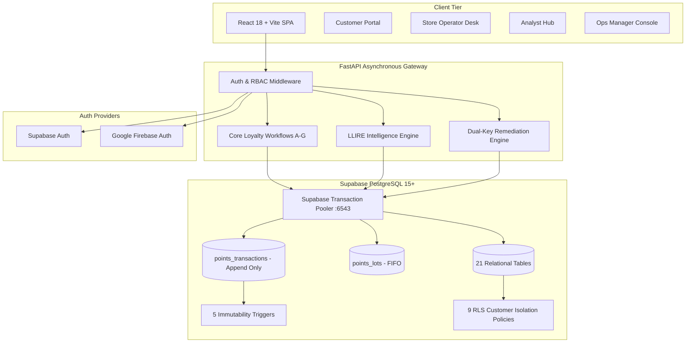
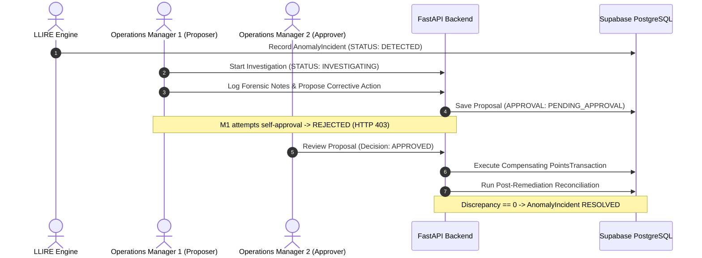

# LoyaltyOS — System Architecture

**Product Name:** LoyaltyOS — Intelligent Loyalty & Ledger Management Platform  
**Repository:** https://github.com/dandetejaswini/LoyaltyOS  
**Core Purpose:** Enterprise loyalty points management, double-entry financial ledger accounting, automated anomaly detection (LLIRE), and dual-key human-controlled remediation.

---

## 1. System Overview

LoyaltyOS provides a mathematically rigorous, auditable loyalty accounting foundation. Unlike conventional loyalty applications that store arbitrary point counters, LoyaltyOS implements an **append-only double-entry financial ledger journal** with **first-in, first-out (FIFO) lot tracking**, automated reconciliation, and an intelligent anomaly detection engine.



---

## 2. Multi-Tier Technology Stack

| Layer | Technology | Key Capabilities |
| :--- | :--- | :--- |
| **Frontend SPA** | React 18, TypeScript 5.4, Vite 5.2 | Role-based operational dashboards, RFC 7807 error handling, zero-mock client state. |
| **Styling & UI** | Tailwind CSS, Lucide React | Deep navy, platinum, and muted lavender enterprise visual hierarchy. |
| **Backend API** | FastAPI, Python 3.11+, Pydantic v2 | Fully asynchronous request lifecycle, dependency-injected database sessions, RFC 7807 ProblemDetails. |
| **ORM & Database** | SQLAlchemy 2.0 Async, PostgreSQL 15+ | `postgresql+asyncpg` driver, explicit transaction boundaries, row-level locking (`with_for_update`). |
| **Migrations** | Alembic | Version-controlled relational migrations registered against `Base.metadata`. |
| **Authentication** | Supabase Auth & Firebase Google OAuth | Cryptographic RS256 / HS256 JWT validation, anti-takeover explicit account linking. |
| **Primary Persistence** | Supabase PostgreSQL | Managed transaction pooler (`aws-0-ap-south-1.pooler.supabase.com:6543`), 5 immutability triggers, 9 RLS policies. |

---

## 3. Core Business Workflows

LoyaltyOS implements seven core business workflows governing point lifecycles:

```
[Customer Provisioning] ──> [Order Accrual] ──> [Ledger Reconciliation]
                                 │
                                 ├──> [FIFO Lot Redemption]
                                 ├──> [Return & Reversal]
                                 ├──> [Idempotent Expiry]
                                 └──> [Tier Evaluation]
```

### Workflow A: Customer Account Provisioning
- Creates an internal `AppUser`, maps authentication providers (`UserIdentityMapping`), and initializes a `Customer` profile.
- Provisions a `LoyaltyAccount` initialized with zero balance, active status, and `TIER-BRONZE`.
- **Idempotency**: Existing emails or customer IDs return the existing account without duplicate provisioning.

### Workflow B: Order Accrual & Floor-Rounding
- Processes gross order amounts, explicitly deducting tax, shipping, and discount amounts to determine **Net Eligible Spend**.
- Applies tier-based earning multipliers:
  $$\text{Points Earned} = \lfloor \text{Net Eligible Spend} \times \text{Tier Multiplier} \rfloor$$
- Creates an immutable credit entry in `points_transactions` and an associated active `PointsLot` with a 365-day expiry.
- Atomically updates `LoyaltyAccount.current_balance`, `lifetime_accrued`, and `qualifying_spend`.

### Workflow C: Double-Entry Ledger Reconciliation
- Verifies the fundamental accounting invariant:
  $$\text{stored\_balance} = \sum_{\text{credits}} \text{points} - \sum_{\text{debits}} \text{points} = \sum \text{active\_lots.remaining\_points}$$
- Detects balance drift without performing silent corruption or unrecorded adjustments.

### Workflow D: FIFO Points Lot Redemption
- Allocates debits against active `PointsLot` records ordered by `expires_at ASC, created_at ASC`.
- Depletes lots sequentially (`ACTIVE` $\to$ `PARTIALLY_REDEEMED` $\to$ `EXHAUSTED`).
- Enforces non-negative balance checks: redemptions fail if `points_required > current_balance`.
- Generates a unique, single-use `voucher_code` linked to the redemption transaction.

### Workflow E: Order Returns & Proportional Reversals
- Reverses points proportionally upon full or partial order returns:
  $$\text{Points Reversed} = \lfloor \text{Refund Amount} \times \text{Accrual Multiplier} \rfloor$$
- Caps reversals at the original order's accrued points.
- **Negative Balance Support**: If accrued points were already redeemed, reversals permit the account balance to become negative, accurately reflecting retail liabilities.

### Workflow F: Idempotent Points Expiry
- Scans lots where `expires_at < cutoff_date` and `remaining_points > 0`.
- Groups expired lots into an `ExpiryBatch` and individual `ExpiryBatchItem` audit entries.
- Deducts expired points from account balances and marks lots as `EXPIRED`.
- Fully idempotent: re-executing expiry across identical time windows yields 0 additional deductions.

### Workflow G: Tier Progression & Evaluation
- Evaluates rolling 365-day qualifying merchandise spend (excluding sales tax and shipping).
- Compares spend against tier thresholds:
  - Bronze: \$0.00 (1.0x)
  - Silver: \$500.00 (1.2x)
  - Gold: \$1,500.00 (1.5x)
  - Platinum: \$3,000.00 (2.0x)
- Upgrades tier status upon crossing thresholds and adjusts earning multipliers.

---

## 4. Business Rules & Invariant Summary

| Rule ID | Name | Mathematical Invariant / Business Requirement |
| :--- | :--- | :--- |
| **BR-01** | Double-Entry Integrity | $\text{Account Balance} \equiv \sum \text{Transactions.points} \equiv \sum \text{ActiveLots.remaining\_points}$. |
| **BR-02** | Accrual Floor Rounding | Accrued points are floored to integers: $\lfloor \text{Spend} \times \text{Multiplier} \rfloor$. Never rounded up. |
| **BR-03** | Eligible Net Spend | $\text{Eligible Spend} = \text{Gross} - \text{Tax} - \text{Shipping} - \text{Discounts}$. Tax/shipping never accrue points. |
| **BR-04** | Accrual Idempotency | Duplicate order accruals with identical `idempotency_key` are rejected without double-crediting. |
| **BR-05** | Qualifying Tier Spend | Tier rank is determined strictly by net merchandise spend, preventing revenue inflation. |
| **BR-06** | FIFO Lot Depletion | Debits consume earliest-expiring lots first (`expires_at ASC, created_at ASC`). |
| **BR-07** | Lot Immutability | $0 \le \text{remaining\_points} \le \text{initial\_points}$. Lots can never be deleted or have balances increase. |
| **BR-08** | Positive Balance for Redemption | Redemptions are blocked if requested points exceed current available balance. |
| **BR-09** | Voucher Code Uniqueness | Every redemption generates a unique cryptographic voucher code. |
| **BR-10** | Negative Balance on Returns | Return reversals subtract points and may drive balance negative if points were already redeemed. |
| **BR-11** | Expiry Idempotency | Expired lots transition to `EXPIRED` status. Repeated runs do not double-expire points. |
| **BR-12** | Dual-Key Remediation | Compensating transactions require two distinct authorized persons: $\text{proposer} \neq \text{approver}$. |

---

## 5. LLIRE — Loyalty Ledger Intelligence & Reconciliation Engine

LLIRE operates as an explainable, auditable intelligence layer detecting accounting discrepancies, velocity fraud, and policy violations.

```
[Raw Ledger & Orders] ──> [LLIRE Detectors (5)] ──> [SHA-256 Fingerprinting] ──> [Incident Triage]
```

### The 5 Anomaly Detectors

1. **Balance Mismatch Detector (`BalanceMismatchDetector`)**:
   - Compares stored `current_balance` with ledger-derived sum and active lot totals.
   - Detects direct database tampering or unjournaled balance updates.
2. **Over-Redemption Detector (`OverRedemptionDetector`)**:
   - Detects redemptions that caused or occurred during negative balances without an underlying return reversal.
   - Separates legitimate return-driven negative balances from fraudulent over-redemptions.
3. **Unreversed Return Detector (`UnreversedReturnDetector`)**:
   - Identifies completed customer returns with positive refunds where no corresponding `RETURN_REVERSAL` transaction was posted.
4. **Double Expiry Detector (`DoubleExpiryDetector`)**:
   - Flags points lots that were expired multiple times across batch runs, detecting double-deduction errors.
5. **Incorrect Tier Calculation Detector (`IncorrectTierDetector`)**:
   - Reconstructs 365-day qualifying spend and flags accounts assigned to tiers based on gross revenue (including tax/shipping).

### Forensic Explainability Structure
Every finding outputs the **7 Mandatory Answers**:
1. What happened?
2. Which entity was involved?
3. Why is this considered anomalous?
4. What baseline or threshold was exceeded?
5. What is the financial exposure / points at risk?
6. What evidence supports this finding (raw JSON payload)?
7. What investigation steps or remediation are recommended?

---

## 6. Controlled Remediation & Dual-Key Approval Lifecycle

Financial records are never modified silently or automatically. Compensating transactions follow a strict two-person control lifecycle:



### Server-Side Dual-Key Rules:
- **Non-Self-Approval**: `proposer_id != approver_id` enforced server-side. Violations return `403 Forbidden`.
- **Compensating Only**: Never edits or deletes historical rows. Posts `ADJUSTMENT_CREDIT` or `ADJUSTMENT_DEBIT`.
- **Post-Remediation Check**: The incident is marked `RESOLVED` only if post-execution discrepancy equals zero.

---

## 7. Security & Separation of Concerns

- **Application-Tier RBAC**: FastAPI enforces roles (`CUSTOMER`, `OPERATOR`, `ANALYST`, `OPERATIONS_MANAGER`) at the API layer based on database-stored roles. Client-supplied role claims are ignored.
- **Client Secret Isolation**: Zero server-side secrets or database passwords exist in frontend source code or bundles.
- **Append-Only Triggers**: Five engine-level PostgreSQL triggers reject `UPDATE` and `DELETE` commands on ledger tables.
- **Row-Level Security (RLS)**: Nine table-level policies protect direct client PostgREST queries.
