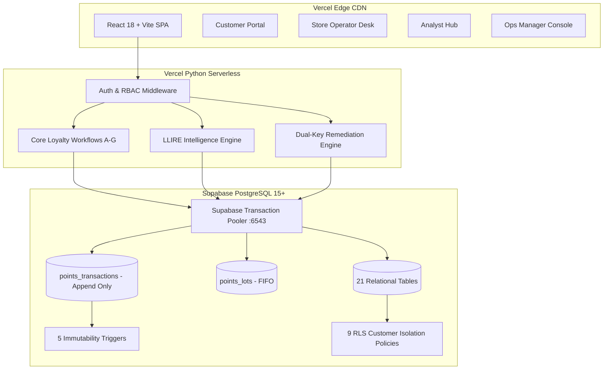
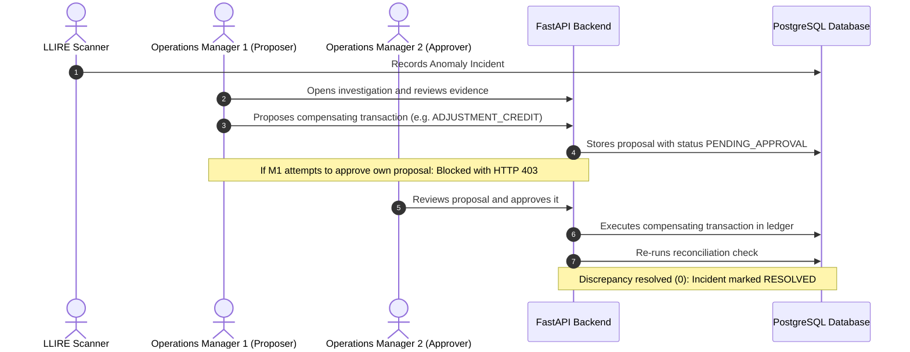

# LoyaltyOS — System Architecture

**Product Name:** LoyaltyOS — Intelligent Loyalty & Ledger Management Platform  
**Repository:** https://github.com/dandetejaswini/LoyaltyOS  
**Core Purpose:** Double-entry loyalty ledger, automated anomaly detection (LLIRE), and dual-key remediation.

---

## 1. System Overview

LoyaltyOS replaces traditional points counters with an **immutable double-entry financial ledger**. Every credit, debit, return, and expiration creates an auditable transaction.

---

## 2. Technology Stack

- **Frontend**: React 18, TypeScript, Vite, Tailwind CSS, Lucide React.
- **Backend API**: FastAPI, Python 3.11+, SQLAlchemy 2.0 Async, Pydantic v2.
- **Database**: Supabase PostgreSQL 15+ using transaction pooler on port 6543.
- **Authentication**: Dual validation for Supabase Auth (HS256) and Google Firebase (RS256).
- **Deployment**: Fullstack Vercel project serving both the static React bundle and Python serverless endpoints.

---

## 3. Core Business Workflows

LoyaltyOS implements seven core workflows to manage points safely:

### Workflow A: Customer Account Provisioning
- Creates user identity and maps external auth providers (Supabase or Firebase).
- Initializes a loyalty account with zero balance in `TIER-BRONZE`.
- Re-registering an existing customer safely returns the existing account without duplicate records.

### Workflow B: Order Accrual
- Calculates points on eligible merchandise spend only (sales tax and shipping are excluded).
- Uses the formula: `Points Earned = floor(Eligible Net Spend * Tier Multiplier)`.
- Writes a credit transaction to `points_transactions` and creates an active points lot with a 365-day expiry.
- Automatically increments account balance, lifetime points, and qualifying annual spend.

### Workflow C: Double-Entry Ledger Reconciliation
- Verifies that `Stored Balance` equals the sum of credits minus debits in the journal.
- Checks that active points lots equal the stored balance.
- Flags any discrepancy as an anomaly without making unrecorded changes.

### Workflow D: FIFO Points Lot Redemption
- Consumes points from the oldest active lot first (`expires_at ASC, created_at ASC`).
- Rejects redemptions if the requested points exceed the available account balance.
- Issues a unique, single-use voucher code upon successful redemption.

### Workflow E: Order Returns & Reversals
- Reverses points proportionally when a customer returns items from an order.
- Caps the reversal to the points originally earned on that order.
- Allows account balance to go negative if points were already spent, showing true retail debt.

### Workflow F: Idempotent Points Expiry
- Identifies lots that have passed their 365-day expiration date with remaining points.
- Groups expired lots into an audit batch and subtracts points from customer balances.
- Running the expiry job multiple times on the same date will not deduct points twice.

### Workflow G: Tier Progression
- Evaluates rolling 365-day merchandise spend against tier thresholds:
  - **Bronze**: \$0.00 spend (1.0x points multiplier)
  - **Silver**: \$500.00 spend (1.2x points multiplier)
  - **Gold**: \$1,500.00 spend (1.5x points multiplier)
  - **Platinum**: \$3,000.00 spend (2.0x points multiplier)
- Automatically upgrades the customer tier and applies the new multiplier to future orders.

---

## 4. Key Business Rules

| Rule ID | Rule Name | Description |
| :--- | :--- | :--- |
| **BR-01** | Ledger Integrity | Account balance must always equal total credits minus total debits. |
| **BR-02** | Floor Rounding | Points are always rounded down to whole integers. No rounding up. |
| **BR-03** | Eligible Net Spend | Points are never awarded on taxes, shipping costs, or order discounts. |
| **BR-04** | Idempotent Accruals | Processing the same order twice is rejected to prevent duplicate points. |
| **BR-05** | Tier Qualification | Tier rank is determined only by merchandise spend, not gross sales. |
| **BR-06** | FIFO Depletion | Oldest points lots are always spent first. |
| **BR-07** | Lot Immutability | Points lots cannot be deleted, and remaining points cannot exceed initial points. |
| **BR-08** | Balance Check | Redemptions are blocked if requested points exceed current balance. |
| **BR-09** | Unique Vouchers | Every redemption generates a unique cryptographic voucher code. |
| **BR-10** | Negative Balances | Returns can drive balances negative if earned points were already redeemed. |
| **BR-11** | Idempotent Expiry | Expiring points multiple times does not produce extra deductions. |
| **BR-12** | Dual-Key Approval | Manual ledger corrections require two separate managers: `proposer != approver`. |

---

## 5. LLIRE Anomaly Intelligence Engine

LLIRE scans ledger records to catch fraud, accounting mistakes, and configuration errors.

### The 5 Anomaly Detectors
1. **Balance Mismatch**: Detects differences between stored account balance and journal calculations.
2. **Over-Redemption**: Detects redemptions that caused negative balances without a matching return.
3. **Unreversed Return**: Finds customer returns where money was refunded but points were not reversed.
4. **Double Expiry**: Detects lots that were incorrectly expired more than once.
5. **Incorrect Tier**: Flags accounts placed in a higher tier based on gross spend rather than eligible spend.

### Forensic Explainability
Every detected anomaly includes:
- Summary of what happened.
- The account, order, or transaction involved.
- The specific rule that was broken.
- Threshold or difference amount.
- Financial exposure and points at risk.
- Supporting JSON evidence.
- Recommended next steps for the investigating manager.

---

## 6. Dual-Key Remediation Workflow

Manual ledger corrections require two people to prevent fraud or accidental changes:

- **Two-Person Rule**: The manager who proposes an adjustment cannot approve it.
- **Compensating Only**: Never edits or deletes past records. Creates an explicit `ADJUSTMENT_CREDIT` or `ADJUSTMENT_DEBIT`.
- **Automatic Verification**: The incident is only marked `RESOLVED` after the database verifies the discrepancy is 0.

---

## 7. Security Controls

- **Database Triggers**: 5 PostgreSQL triggers block `UPDATE` and `DELETE` queries on ledger tables.
- **Customer Privacy**: 9 Supabase Row-Level Security (RLS) policies prevent customers from seeing other users' data.
- **Server-Side Roles**: User permissions (`CUSTOMER`, `OPERATOR`, `ANALYST`, `OPERATIONS_MANAGER`) are checked directly against the database on every request.
- **Safe Frontend Bundles**: No private database credentials or API secrets are included in client code.
