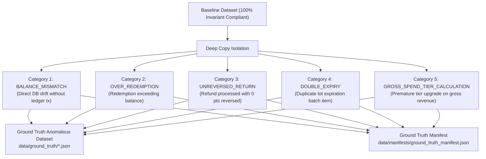

# LoyaltyOS — Synthetic Data Generation & Deterministic Engine Design

## 1. Executive Summary

The LoyaltyOS Synthetic Data Engine provides an enterprise-grade, mathematically deterministic generation and validation pipeline. Built to support auditing, compliance testing, and the Loyalty Ledger Incident Resolution Engine (LLIRE), the engine produces realistic customer behavioral patterns, transactional histories, FIFO points lots, and controlled anomaly datasets without introducing non-deterministic drift.

The pipeline is pinned to master random seed `20261022`, guaranteeing bit-exact cross-platform reproducibility across environments.

---

## 2. Mathematical Formulations & Accounting Invariants

The data generator strictly adheres to the core Phase 0 business rules (BR-01 through BR-12):

### 2.1 Double-Entry Ledger Invariant (BR-01)

Every customer account balance is an exact derivative of its journal transactions. Direct modification of `loyalty_accounts.current_balance` without a corresponding `points_transactions` journal entry is strictly prohibited:

$$\text{current\_balance}_i = \sum_{t \in T_i} \text{points}_t$$

$$\text{running\_balance}_{i, k} = \sum_{j=1}^{k} \text{points}_{i, j}$$

Where $T_i$ represents the ordered set of all points transactions for account $i$.

### 2.2 Eligible Net Spend Calculation (BR-01 / BR-05)

Points accrual and tier qualifications evaluate net merchandise spend only, strictly excluding taxes, shipping, excluded gift cards, and order-level discounts:

$$\text{Eligible Net Spend} = \sum_{l \in L_{\text{eligible}}} \left( \text{Quantity}_l \times \text{Unit Price}_l - \text{Line Discount}_l \right)$$

Order-level taxes ($\sim 8\%$) and shipping fees are recorded in the order header but never factored into points accrual or qualifying spend.

### 2.3 Floor Rounding on Accruals (BR-02)

To maintain absolute financial conservatism, points are floored to the nearest integer. Fractional points are never rounded up or rounded half-up:

$$\text{Points Accrued} = \left\lfloor \text{Eligible Net Spend} \times \text{Tier Multiplier} \right\rfloor$$

### 2.4 FIFO Points Lot Allocation (BR-06)

Points lots represent accrued points subject to a 365-day expiration window. When a customer redeems points, the system satisfies the redemption by exhausting active lots in strict First-In, First-Out order:

$$\text{Order of Allocation}: \operatorname{sort}(\text{lots}, \text{key} = (\text{expires\_at ASC}, \text{created\_at ASC}))$$

For each lot $L$:
$$\text{allocated}_L = \min(L.\text{remaining\_points}, \text{points\_needed} - \text{total\_allocated})$$
$$L.\text{remaining\_points} \leftarrow L.\text{remaining\_points} - \text{allocated}_L$$

### 2.5 Negative Balance Support on Returns (BR-10)

When merchandise is returned, accrued points are reversed:

$$\text{Points Reversed} = \left\lfloor \text{Refund Amount} \times \text{Tier Multiplier} \right\rfloor$$

If the customer has already redeemed the accrued points, the reversal is still processed in full, driving the customer's `current_balance` into a negative state. While redemptions are blocked from driving a balance below zero (BR-08), returns are intentionally permitted to result in a negative balance to reflect the customer's true net liability.

### 2.6 Lot Expiration (BR-11)

Lots that remain unredeemed 365 days after accrual are expired via automated batches. The expiration reduces `current_balance` by exactly $L.\text{remaining\_points}$ and transitions lot status to `EXPIRED`.

---

## 3. Scale Profiles

| Profile | Customers | Orders | Target Transactions | Generation Time |
| :--- | :--- | :--- | :--- | :--- |
| **TEST** | 100 | 500 | ~600 | < 1 second |
| **MEDIUM** | 1,000 | 5,000 | ~6,000 | ~2 seconds |
| **FULL** | 20,000 | 100,000 | ~300,000 | ~45 seconds |

---

## 4. Controlled Anomaly Injection Schema

To benchmark forensic audit engines and the upcoming LLIRE resolution engine, the pipeline creates an isolated deep copy of the baseline dataset and injects controlled anomalies across 5 forensic categories:

### Anomaly Category Specifications

1. **`BALANCE_MISMATCH`**: Direct database drift injected by modifying an account's `current_balance` without a corresponding transaction, violating BR-01 double-entry invariant.
2. **`OVER_REDEMPTION`**: An unauthorized redemption transaction created where `points_redeemed` exceeds the customer's available positive balance, violating BR-08.
3. **`UNREVERSED_RETURN`**: An order return recorded with a full monetary refund, but `points_reversed = 0`, violating BR-10.
4. **`DOUBLE_EXPIRY`**: A previously expired points lot is processed a second time in an expiry batch, deducting points twice, violating BR-11 idempotency.
5. **`GROSS_SPEND_TIER_CALCULATION`**: A customer is elevated to Gold tier based on gross order amount (including tax and shipping) when qualifying net merchandise spend was below the $1,000 threshold, violating BR-05.

---

## 5. Checksum and Manifest Verification

Every generation run produces SHA-256 cryptographic checksums for both the baseline and anomalous datasets. The output manifest records:
- Master random seed (`dataset_seed`)
- Scale profile and generator version
- Entity count breakdown across all 12 tables
- Per-category anomaly distribution
- Exact entity identifiers and injected vs expected values for automated scoring
- SHA-256 digest of serialized payloads
